---
## Author
author:
  name: Умед Джамшедович Назармамадов
  affiliation:
    - name: Российский университет дружбы народов
      country: Российская Федерация
      postal-code: 117198
      city: Москва
      address: ул. Миклухо-Маклая, д. 6

## Title
title: "Лабораторная работа №4"
subtitle: "Линейная алгебра"
license: "CC BY"
abstract: |
  В отчёте описано изучение возможностей специализированных пакетов Julia (`Statistics`, `LinearAlgebra`, `BenchmarkTools`) для выполнения и оценки эффективности операций над объектами линейной алгебры.

  Воспроизведены примеры из методических указаний: поэлементные операции над массивами, транспонирование, ранг, определитель и обратная матрица, нормы и повороты, матричное умножение, LU-, QR- и спектральное разложения, работа с матрицами специальной структуры и рациональными матрицами. Выполнены задания для самостоятельной работы: произведения векторов, системы линейных уравнений, диагонализация матриц, функции от матриц, линейные модели экономики.

  Все результаты подтверждены скриншотами выполнения кода в Jupyter Lab.
keywords: [Julia, линейная алгебра, LinearAlgebra, BenchmarkTools, СЛАУ, собственные значения, лабораторная работа]
---

# Введение

## Актуальность

Линейная алгебра лежит в основе большинства методов статистического анализа данных: регрессии, метода главных компонент, решения систем уравнений, моделирования динамических и экономических систем. Julia содержит встроенную поддержку линейной алгебры через стандартный пакет `LinearAlgebra`, использующий библиотеки BLAS и LAPACK, поэтому умение выбирать подходящие функции и типы матриц напрямую влияет на скорость и надёжность вычислений.

## Цель работы

Изучить возможности специализированных пакетов Julia для выполнения и оценки эффективности операций над объектами линейной алгебры.

## Задачи

1. Используя Jupyter Lab, повторить примеры из раздела 4.2 методических указаний.
2. Выполнить задания для самостоятельной работы (раздел 4.4):
    - произведения векторов (скалярное и внешнее);
    - решение систем линейных алгебраических уравнений с двумя и тремя неизвестными;
    - приведение матриц к диагональному виду, вычисление степеней и корней матриц, оценка эффективности операций над матрицей $5 \times 5$;
    - проверка продуктивности матриц в линейной модели экономики.

## Объект и предмет исследования

Объект исследования — пакеты Julia `Statistics`, `LinearAlgebra` и `BenchmarkTools`. Предмет исследования — операции над векторами и матрицами: поэлементные операции, факторизации, решение СЛАУ, собственные значения, работа с матрицами специальной структуры, оценка времени выполнения.

## Методы исследования

Практическая работа в интерактивной среде Jupyter Lab (ядро IJulia): последовательное выполнение примеров и заданий в ячейках блокнота, анализ полученных результатов, измерение времени выполнения макросом `@btime`.

## Схема выполнения работы

На рис. -@fig-flowchart представлена общая последовательность действий при выполнении работы.

::: {#fig-flowchart}

```{mermaid}
%%| fig-width: 100%
graph TD
    A@{ shape: circle, label: "Начало" } --> B[Выполнить действие]
    B --> C[Описать, что конкретно сделано]
    C --> D[Подтвердить скриншотом]
    D --> E[Занести в отчёт]
    E --> F[Поместить в git-репозиторий]
    F --> G[Сделать релиз git]
    G --> J@{ shape: dbl-circ, label: "Конец" }
```

Блок-схема выполнения лабораторной работы

:::

# Теоретическая часть

**Нормы.** Евклидова норма вектора $\vec{x}$ — $\|\vec{x}\|_2 = \sqrt{x_1^2 + \dots + x_n^2}$, $p$-норма — $\|\vec{x}\|_p = \left(\sum_{i=1}^{n} |x_i|^p\right)^{1/p}$. Евклидово расстояние между векторами — $\|\vec{x} - \vec{y}\|_2$, угол между ними — $\arccos \dfrac{\vec{x}^T \vec{y}}{\|\vec{x}\|_2 \|\vec{y}\|_2}$.

**Факторизации.** Факторизация (разложение) матрицы — её представление в виде произведения матриц специального вида:

- LU-разложение: $A = LU$, где $L$ — нижняя, $U$ — верхняя треугольная матрица; с перестановкой строк — LUP-разложение $PA = LU$;
- QR-разложение: $A = QR$, где $Q$ — ортогональная ($Q^T Q = I$), $R$ — верхняя треугольная матрица;
- спектральное разложение: $A = V \Lambda V^{-1}$, где столбцы $V$ — собственные векторы, $\Lambda$ — диагональная матрица собственных значений.

**Матрицы специальной структуры.** Явное указание структуры (`Symmetric`, `Diagonal`, `LowerTriangular`, `SymTridiagonal` и др.) позволяет Julia использовать специализированные, более быстрые алгоритмы и хранить только существенные элементы матрицы.

**Линейная модель экономики** записывается как СЛАУ $x - Ax = y$, где элементы матрицы $A$ и векторов $x$, $y$ неотрицательны. Матрица $A$ называется продуктивной, если решение $x$ при любой неотрицательной правой части $y$ неотрицательно. Эквивалентные критерии продуктивности:

- матрица $(E - A)^{-1}$ имеет только неотрицательные элементы;
- все собственные значения матрицы $A$ по модулю меньше 1 (спектральный критерий).

Основные использованные функции перечислены в табл. -@tbl-functions.

| Функция | Назначение | Пакет |
|---------|------------|-------|
| `sum`, `prod`, `mean` | сумма, произведение, среднее (в том числе по осям `dims`) | `Base`, `Statistics` |
| `transpose`, `tr`, `diag`, `rank`, `inv`, `det`, `pinv` | транспонирование, след, диагональ, ранг, обратная, определитель, псевдообратная | `LinearAlgebra` |
| `norm`, `opnorm` | норма вектора, норма матрицы | `LinearAlgebra` |
| `lu`, `qr`, `eigen`, `eigvals` | LU-, QR-, спектральное разложение, собственные значения | `LinearAlgebra` |
| `Symmetric`, `Diagonal`, `LowerTriangular`, `SymTridiagonal` | типы матриц специальной структуры | `LinearAlgebra` |
| `@btime` | измерение времени выполнения | `BenchmarkTools` |

: Основные функции, используемые в работе {#tbl-functions}

# Материалы и методы

Работа выполнена в следующем окружении:

- ОС: WSL2 Ubuntu (Windows);
- Julia 1.10, Jupyter Lab, ядро IJulia;
- пакеты: `Statistics` (v1.10.0), `LinearAlgebra` (стандартная библиотека), `BenchmarkTools` (v1.8.0);
- рабочее пространство организовано по шаблону курса, лабораторная выполнена в ветке `feature/lab04` git-репозитория `2026-2--study--computer-practice`, блокнот — `labs/lab04/project/linear-algebra.ipynb`.

Последовательность действий: создание ветки через git-flow, запуск Jupyter Lab, создание блокнота с ядром Julia, последовательное выполнение примеров раздела 4.2 и заданий раздела 4.4 с фиксацией результатов скриншотами.

# Выполнение лабораторной работы

## Подготовка рабочего пространства

Для лабораторной работы создана ветка `feature/lab04` командой `git flow feature start lab04` (рис. -@fig-001).

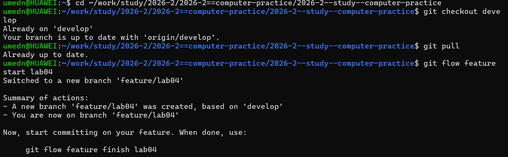{#fig-001 width=90%}

Создан каталог для проекта лабораторной работы `labs/lab04/project` (рис. -@fig-002).

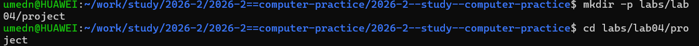{#fig-002 width=90%}

Запущен Jupyter Lab (рис. -@fig-003).

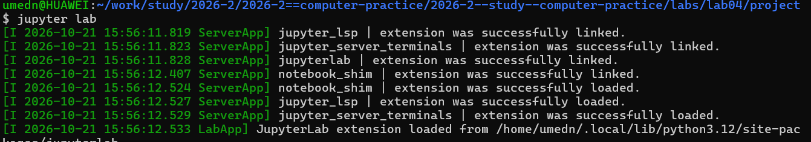{#fig-003 width=90%}

## Поэлементные операции над многомерными массивами (раздел 4.2.1)

В блокноте создана матрица `a` размера $4 \times 3$ со случайными целыми числами от 1 до 20. Вычислены поэлементная сумма всех элементов, суммы по столбцам (`dims=1`) и по строкам (`dims=2`), а также поэлементное произведение (рис. -@fig-004).

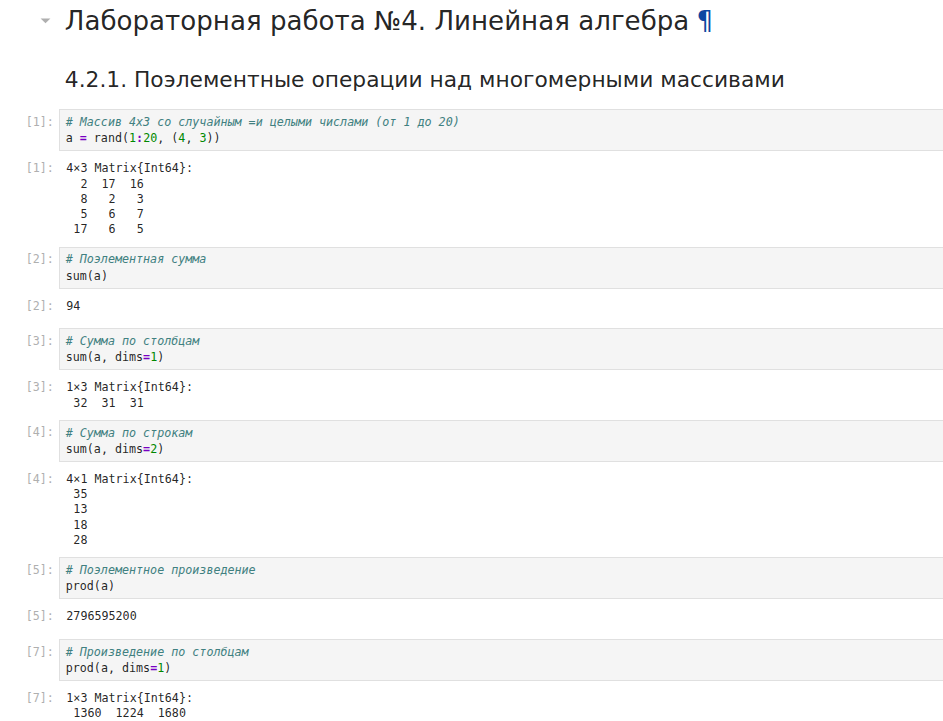{#fig-004 width=90%}

Далее вычислены произведения по строкам. Для работы со средними значениями подключён пакет `Statistics`, вычислены среднее значение массива, средние по столбцам и по строкам (рис. -@fig-005).

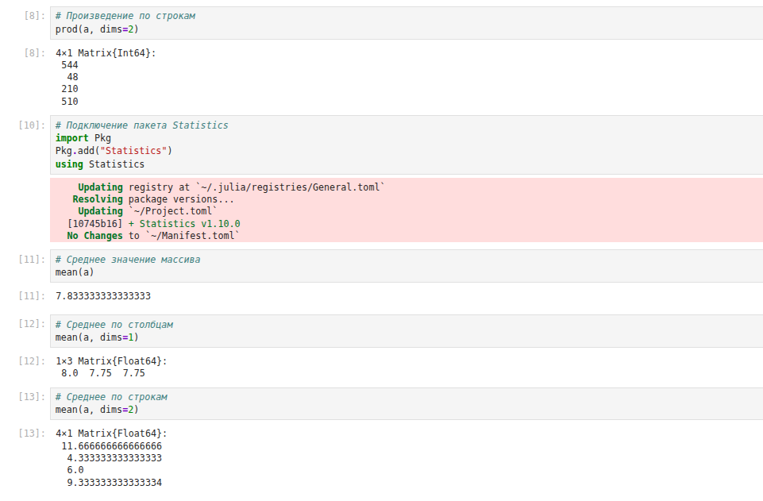{#fig-005 width=90%}

## Транспонирование, след, ранг, определитель и инверсия матрицы (раздел 4.2.2)

Подключён пакет `LinearAlgebra`, создана матрица `b` размера $4 \times 4$. Выполнены транспонирование, вычисление следа, извлечение диагонали, вычисление ранга (рис. -@fig-006).

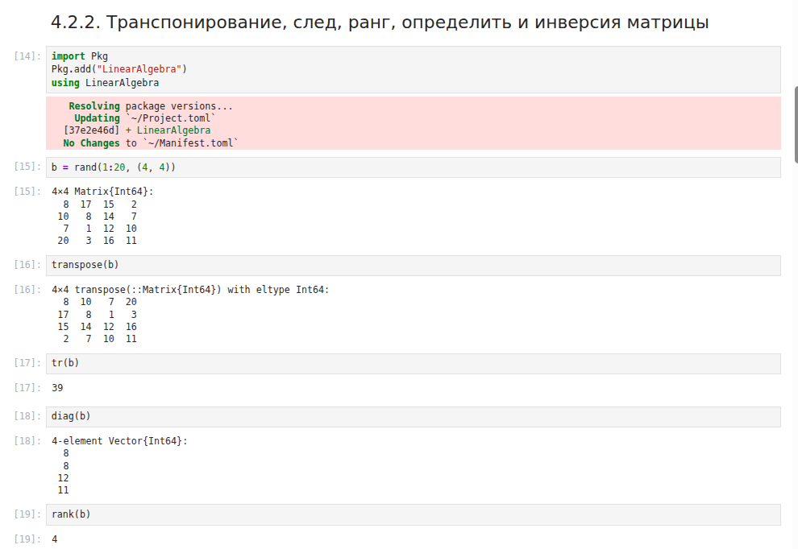{#fig-006 width=90%}

Вычислены обратная матрица `inv(b)`, определитель `det(b)` и псевдообратная матрица `pinv(b)` (рис. -@fig-007). Для квадратной невырожденной матрицы обратная и псевдообратная матрицы совпадают.

## Нормы векторов и матриц, повороты (раздел 4.2.3)

Для вектора $X = (2, 4, -5)$ вычислены евклидова норма и $p$-норма при $p = 1$. Евклидово расстояние между векторами $X$ и $Y = (1, -1, 3)$ найдено функцией `norm(X - Y)` и проверено по базовому определению `sqrt(sum((X - Y).^2))` — результаты совпали. Вычислен угол между векторами (рис. -@fig-007).

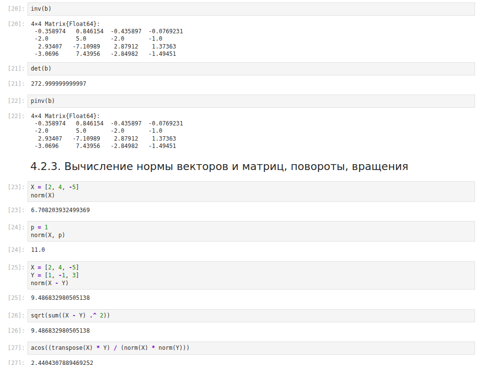{#fig-007 width=90%}

Для матрицы `d` вычислены евклидова норма и $p$-норма (`opnorm`), выполнены поворот на 180 градусов (`rot180`), переворачивание строк и столбцов (`reverse`) (рис. -@fig-008).

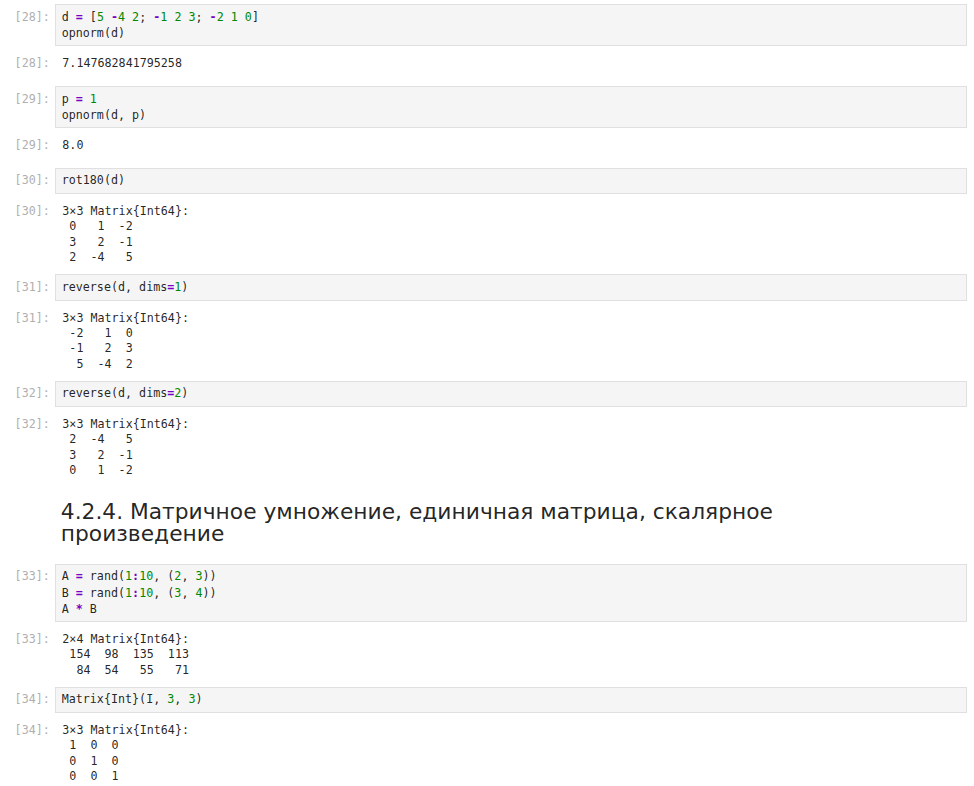{#fig-008 width=90%}

## Матричное умножение, единичная матрица, скалярное произведение (раздел 4.2.4)

Созданы матрицы $A$ ($2 \times 3$) и $B$ ($3 \times 4$), вычислено произведение `A * B` — матрица $2 \times 4$ (рис. -@fig-008). Создана единичная матрица $3 \times 3$ (`Matrix{Int}(I, 3, 3)`). Скалярное произведение векторов $X$ и $Y$ вычислено двумя способами: `dot(X, Y)` и `X' * Y` — оба дали значение $-17$ (рис. -@fig-009).

## Факторизация. Специальные матричные структуры (раздел 4.2.5)

Задана случайная матрица $A$ размера $3 \times 3$, единичный вектор `x` и вектор $b = Ax$. Решение системы $Ax = b$ оператором `\` вернуло вектор, равный единичному с точностью до погрешности вычислений. Выполнено LU-факторизация `lu(A)` (рис. -@fig-009).

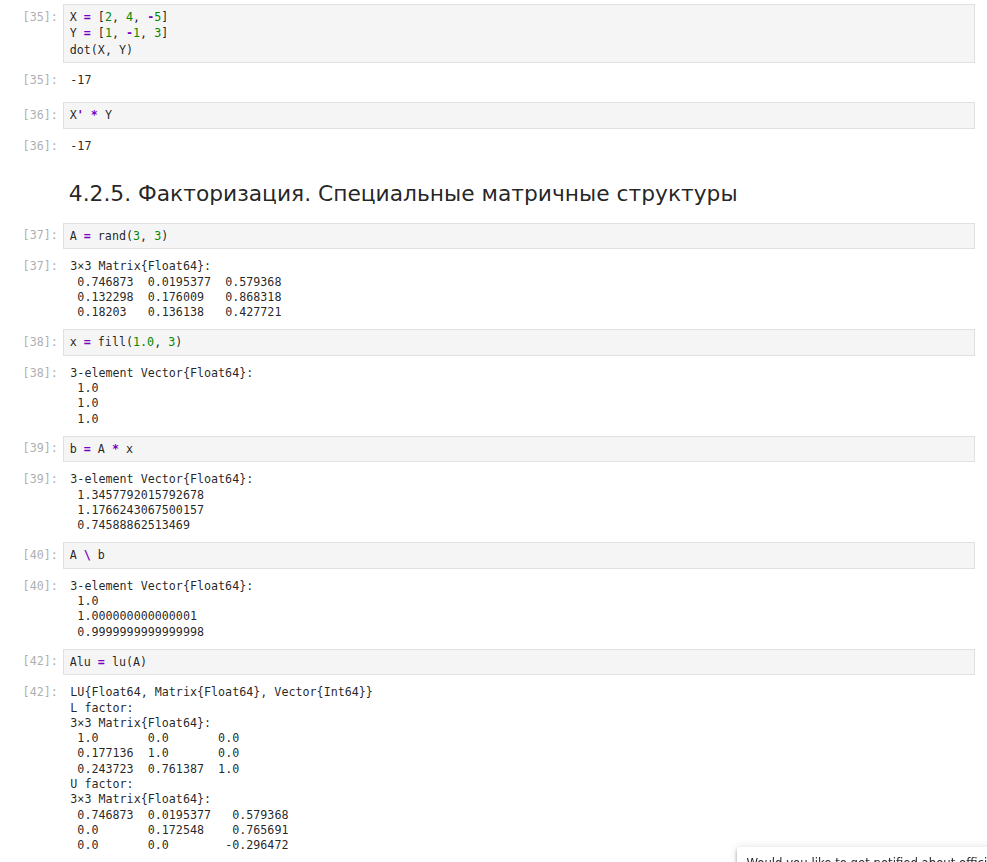{#fig-009 width=90%}

Из объекта факторизации извлечены вектор перестановок, матрицы $L$ и $U$. Система решена двумя способами — через матрицу `A` и через объект факторизации `Alu`, определитель вычислен через `det(A)` и `det(Alu)`; результаты совпадают (рис. -@fig-010).

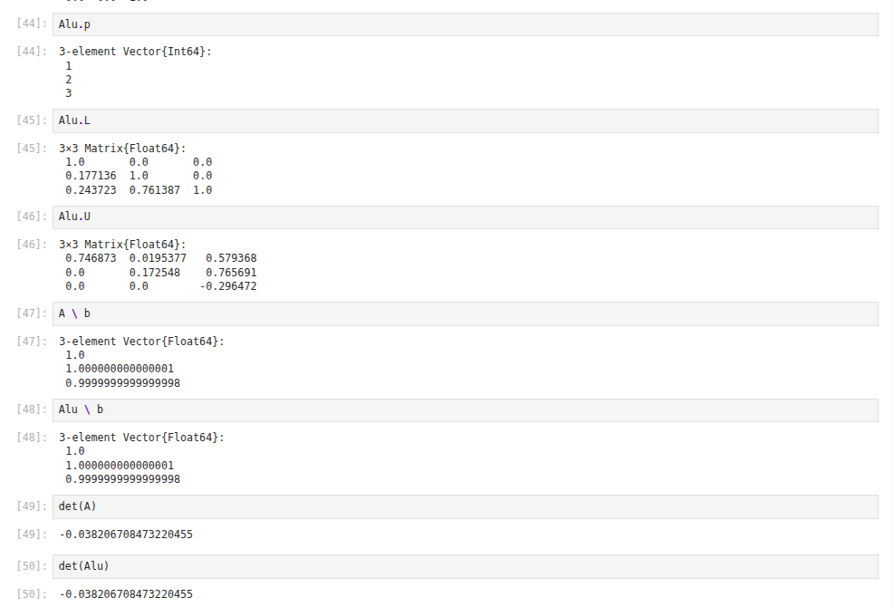{#fig-010 width=90%}

Выполнена QR-факторизация `qr(A)`, извлечены матрицы $Q$ и $R$, проверена ортогональность матрицы $Q$ (произведение $Q^T Q$ равно единичной матрице с точностью до погрешности порядка $10^{-16}$). Матрица симметризована ($A_{sym} = A + A^T$) и для неё выполнено спектральное разложение `eigen(Asym)` (рис. -@fig-011).

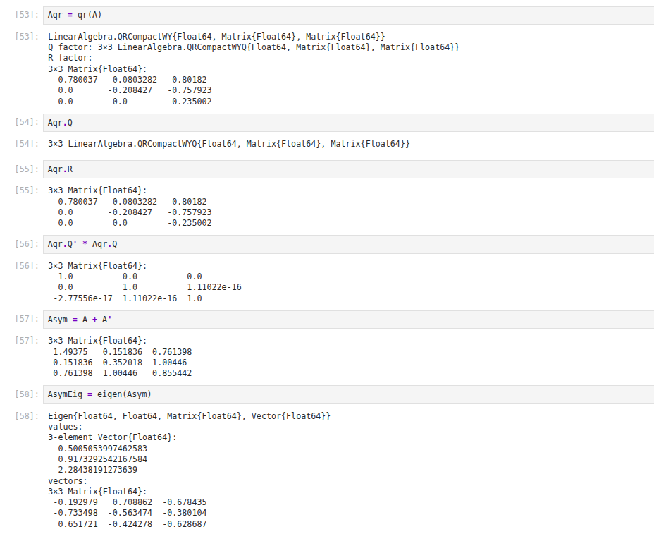{#fig-011 width=90%}

Проверка `inv(AsymEig) * Asym` даёт единичную матрицу. Для оценки эффективности подключён пакет `BenchmarkTools`, создана случайная матрица $1000 \times 1000$ (рис. -@fig-012, рис. -@fig-013).

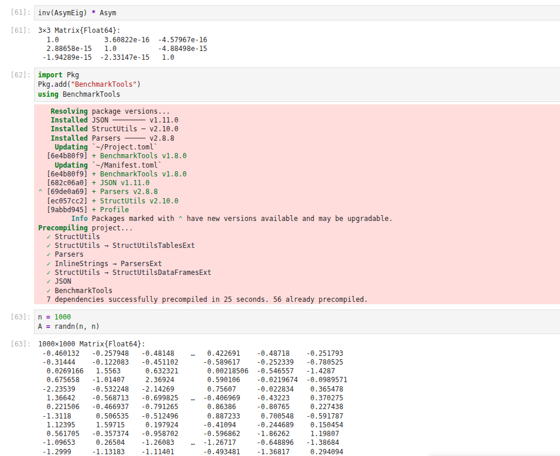{#fig-012 width=90%}

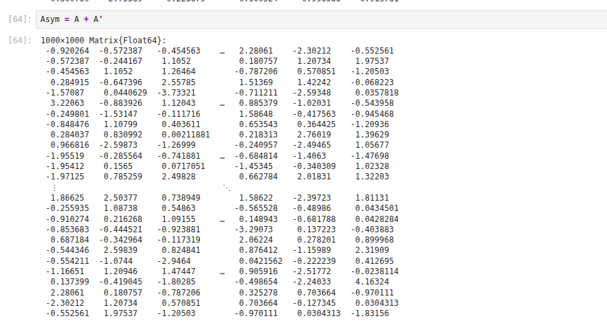{#fig-013 width=90%}

Проверка `issymmetric` для симметризованной матрицы даёт `true`. После добавления шума `5eps()` в элемент `[1, 2]` матрица перестаёт быть симметричной (`false`), для неё явно задана структура `Symmetric` (рис. -@fig-014).

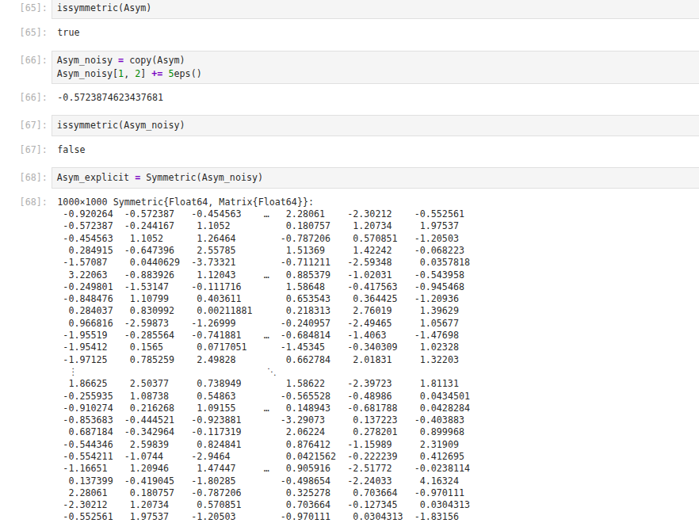{#fig-014 width=90%}

Оценено время вычисления собственных значений для трёх матриц (рис. -@fig-015).

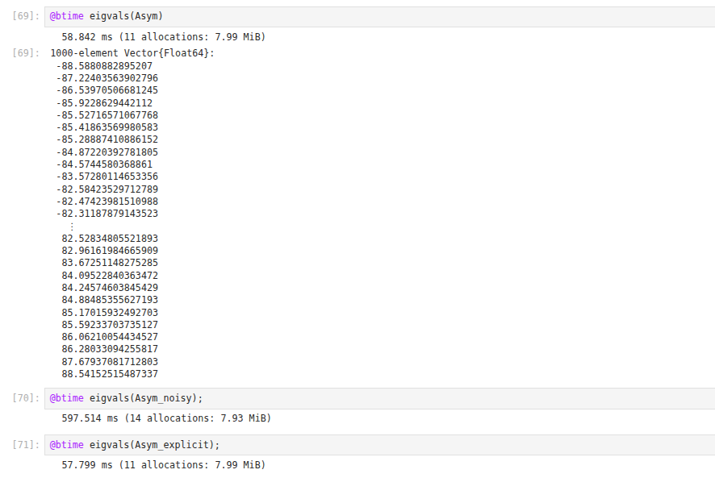{#fig-015 width=90%}

Для разреженной структуры создана трёхдиагональная симметричная матрица `SymTridiagonal` размера $10^6 \times 10^6$ и измерено время нахождения наибольшего собственного значения `eigmax` (рис. -@fig-016).

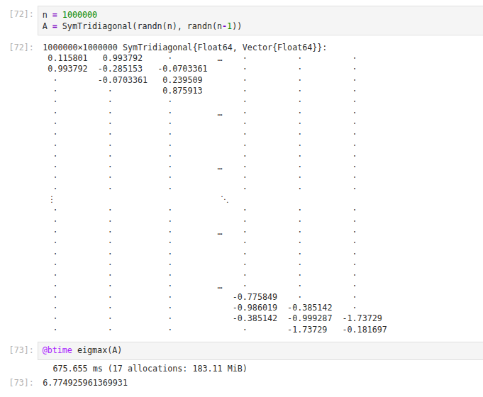{#fig-016 width=90%}

## Общая линейная алгебра (раздел 4.2.6)

Создана матрица с рациональными элементами `Rational{BigInt}` и вектор `b = Arational * x`. Решение СЛАУ оператором `\` вернуло вектор из единиц в точном (рациональном) виде, без погрешностей округления; выполнено LU-разложение рациональной матрицы (рис. -@fig-017).

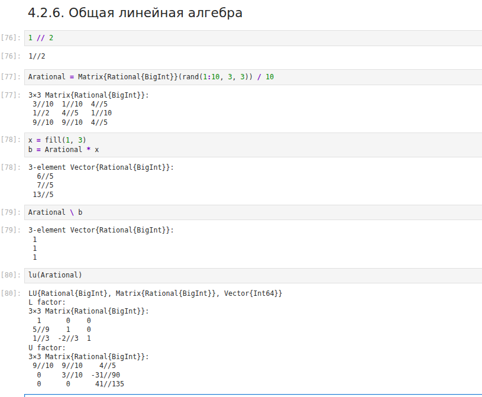{#fig-017 width=90%}

## Задания для самостоятельной работы (раздел 4.4)

### Произведение векторов (4.4.1)

Задан вектор `v = [1, 2, 3]`. Скалярное произведение `v` на себя сохранено в `dot_v` (получено 14), внешнее произведение `v * v'` сохранено в `outer_v` (матрица $3 \times 3$) (рис. -@fig-018).

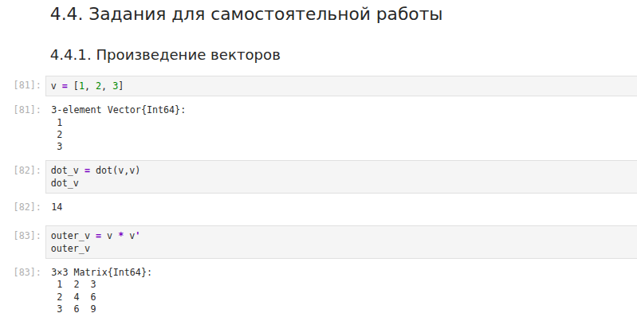{#fig-018 width=90%}

### Системы линейных уравнений (4.4.2)

Для анализа систем $Ax = b$ написана функция `solve_slau`, которая сравнивает ранг матрицы системы $\mathrm{rank}(A)$ и ранг расширенной матрицы $\mathrm{rank}([A|b])$ (теорема Кронекера — Капелли), определяет тип системы (единственное решение, бесконечно много решений, несовместность) и пробует решить систему оператором `\` (рис. -@fig-019).

Системы с двумя неизвестными. Система (a) имеет единственное решение $x = 2.5$, $y = -0.5$; в системе (b) уравнения пропорциональны (ранги равны 1, решений бесконечно много), оператор `\` выдаёт `SingularException`; система (c) несовместна ($\mathrm{rank}(A) = 1 < \mathrm{rank}([A|b]) = 2$).

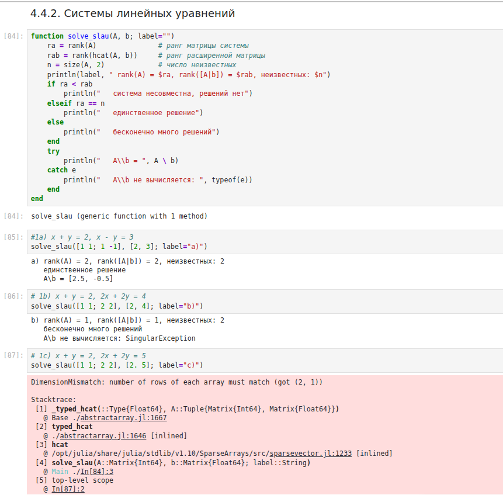{#fig-019 width=90%}

В системе (d) три пропорциональных уравнения, решений бесконечно много, оператор `\` возвращает решение минимальной нормы. Система (e) несовместна, оператор `\` возвращает приближённое решение по методу наименьших квадратов. Система (f) совместна и имеет единственное решение $x = -1$, $y = 3$ (рис. -@fig-020).

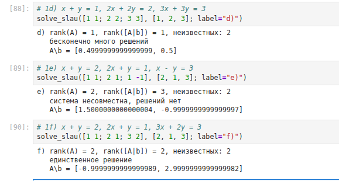{#fig-020 width=90%}

Системы с тремя неизвестными (рис. -@fig-021): в (a) два уравнения и три неизвестных — решений бесконечно много; (b) — единственное решение $(-0.5;\ 2.5;\ 0)$; (c) — решений бесконечно много (матрица вырождена, ранг 2, система совместна); (d) — система несовместна ($\mathrm{rank}(A) = 2$, $\mathrm{rank}([A|b]) = 3$).

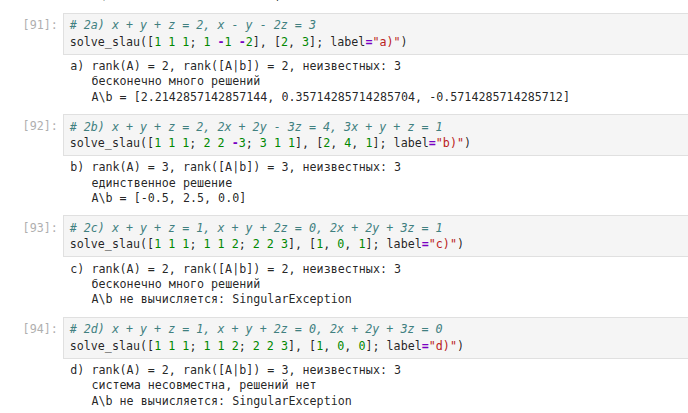{#fig-021 width=90%}

### Операции с матрицами (4.4.3)

Написана функция `diagonalize`, выполняющая спектральное разложение $A = V \Lambda V^{-1}$ и проверку результата. Для матриц (a)–(c) получены собственные значения: (a) $-1$ и $3$; (b) $-0.236$ и $4.236$; (c) $-2.141$, $0.515$, $3.626$. Во всех случаях проверка $V \Lambda V^{-1} \approx A$ дала `true` (рис. -@fig-022).

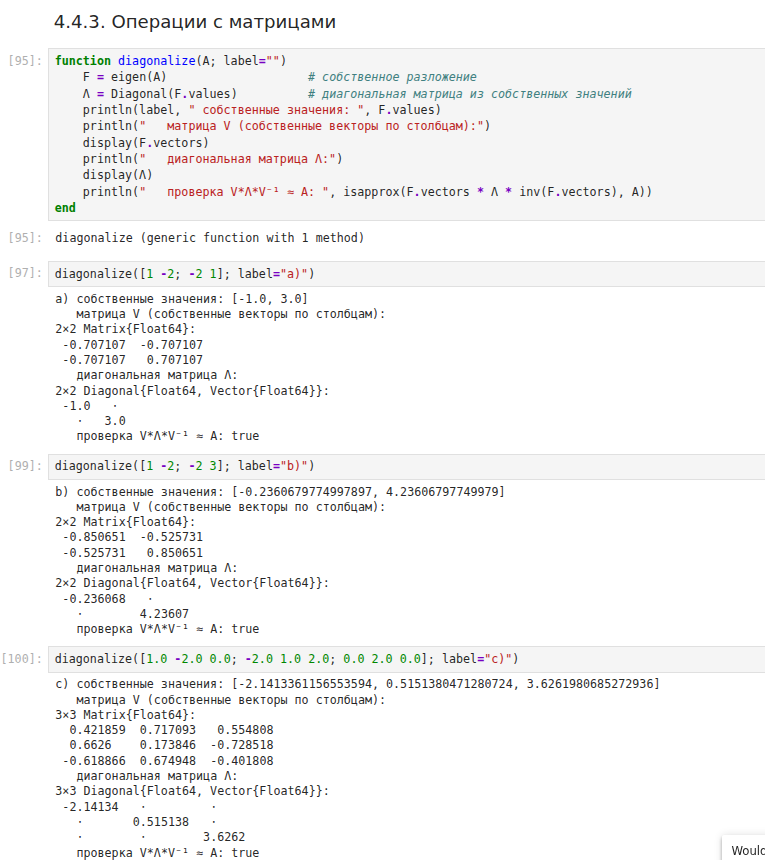{#fig-022 width=90%}

Вычислены функции от матриц (рис. -@fig-023):

- $\begin{pmatrix} 1 & -2 \\ -2 & 1 \end{pmatrix}^{10} = \begin{pmatrix} 29525 & -29524 \\ -29524 & 29525 \end{pmatrix}$;
- квадратный корень из $\begin{pmatrix} 5 & -2 \\ -2 & 5 \end{pmatrix}$ — встроенной функцией `sqrt`, проверка: квадрат результата равен исходной матрице;
- кубический корень из $\begin{pmatrix} 1 & -2 \\ -2 & 1 \end{pmatrix}$ — через собственное разложение $V \cdot \mathrm{diag}(\sqrt[3]{\lambda_i}) \cdot V^{-1}$, проверка: куб результата равен исходной матрице.

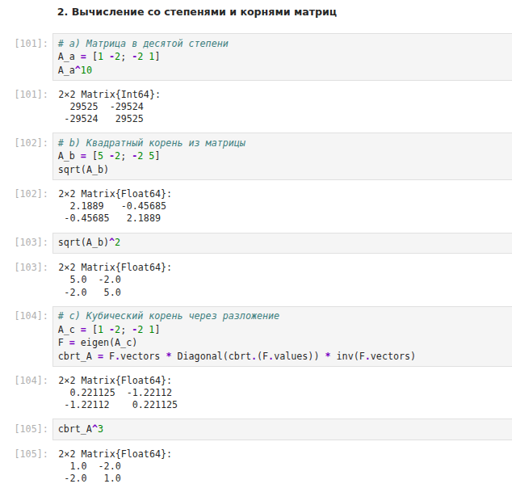{#fig-023 width=90%}

У матрицы $\begin{pmatrix} 1 & 2 \\ 2 & 3 \end{pmatrix}$ одно собственное значение отрицательное ($-0.236$ и $4.236$), поэтому вещественного квадратного корня не существует. Функция `sqrt` вернула комплексную матрицу, тот же результат получен через собственное разложение с переходом к комплексным числам; проверка (квадрат результата) вернула исходную матрицу с точностью до мнимых частей порядка $10^{-17}$ (рис. -@fig-024).

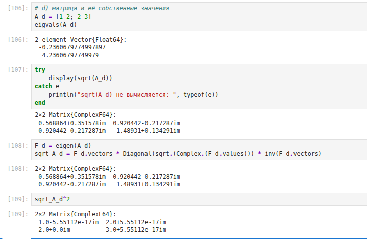{#fig-024 width=90%}

Для симметричной матрицы $5 \times 5$ вычислены собственные значения ($-128.493$; $-55.888$; $42.752$; $87.161$; $542.468$), построены диагональная матрица из собственных значений (`Diagonal`) и нижнетреугольная матрица (`LowerTriangular`), измерено время выполнения операций макросом `@btime` (рис. -@fig-025).

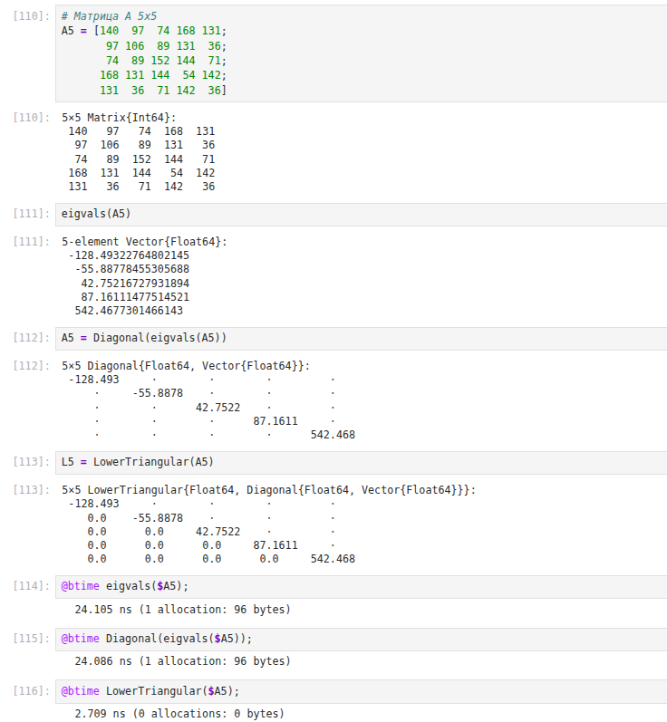{#fig-025 width=90%}

### Линейные модели экономики (4.4.4)

Продуктивность матриц проверена тремя способами. По определению: для базисных неотрицательных векторов $y = (1, 0)$ и $y = (0, 1)$ решается система $(E - A)x = y$ и проверяется неотрицательность $x$ (рис. -@fig-026). Матрицы (a) и (b) не продуктивны (в решении появляются отрицательные компоненты), матрица (c) продуктивна.

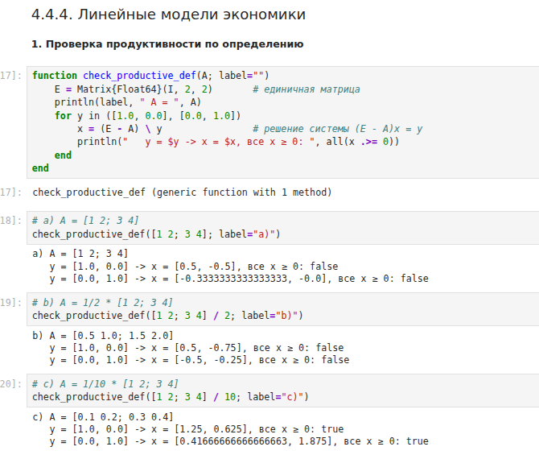{#fig-026 width=90%}

По критерию $(E - A)^{-1} \geq 0$ (рис. -@fig-027): для матрицы (a) обратная матрица содержит отрицательные элементы, для (b) — тоже, для (c) все элементы неотрицательны.

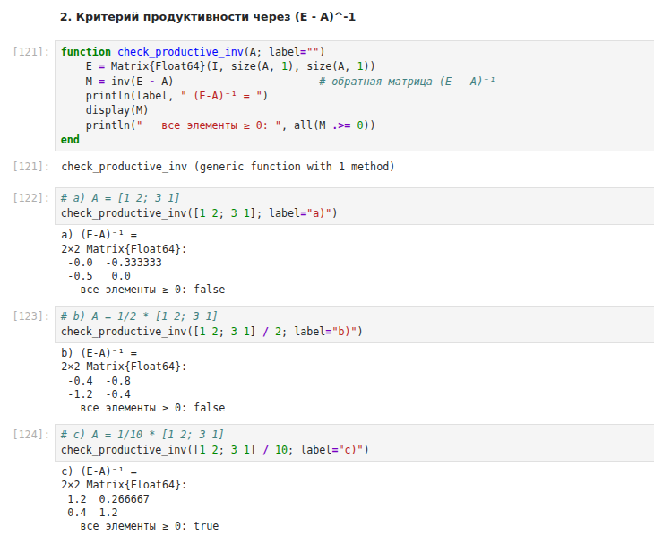{#fig-027 width=90%}

По спектральному критерию (рис. -@fig-028): у матрицы (a) собственные значения $-1.449$ и $3.449$, у (b) — $-0.725$ и $1.725$ (есть $|\lambda| > 1$, матрицы не продуктивны); у (c) — $-0.145$ и $0.345$, у (d) — $0.027$; $0.1$; $0.373$ (все $|\lambda| < 1$, матрицы продуктивны).

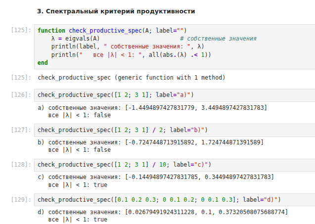{#fig-028 width=90%}

# Результаты

- Примеры раздела 4.2 воспроизведены, результаты соответствуют методическим указаниям: суммы, произведения и средние по осям, транспонирование, след, ранг, определитель, обратная и псевдообратная матрицы, нормы и расстояния, повороты, матричное и скалярное произведения, LU-, QR- и спектральное разложения, работа с матрицами специальной структуры и с рациональными матрицами.
- Скалярное произведение векторов $X = (2, 4, -5)$ и $Y = (1, -1, 3)$ равно $-17$ при вычислении как `dot(X, Y)`, так и `X' * Y`.
- Время вычисления собственных значений матрицы $1000 \times 1000$ (рис. -@fig-015): симметричная матрица — 58.8 мс, зашумлённая (несимметричная) — 597.5 мс, зашумлённая с явным указанием `Symmetric` — 57.8 мс.
- Наибольшее собственное значение трёхдиагональной матрицы $10^6 \times 10^6$ типа `SymTridiagonal` найдено за 675.7 мс при выделении 183.11 МиБ памяти.
- Система с рациональной матрицей решена точно: получен вектор $(1, 1, 1)$ без погрешностей округления.
- Задание 4.4.1: $\mathrm{dot\_v} = 14$, `outer_v` — матрица $3 \times 3$ с элементами $v_i v_j$.
- Задание 4.4.2: определены типы всех десяти систем (табл. -@tbl-slau).
- Задание 4.4.3: матрицы приведены к диагональному виду, вычислены степень, квадратные и кубический корни, найдены собственные значения матрицы $5 \times 5$.
- Задание 4.4.4: матрицы (a) и (b) не продуктивны, матрица (c) продуктивна по всем применённым критериям; матрица (d) продуктивна по спектральному критерию.

| Система | Число неизвестных | Тип системы |
|---------|-------------------|-------------|
| 1a | 2 | единственное решение $(2.5;\ -0.5)$ |
| 1b | 2 | бесконечно много решений |
| 1c | 2 | несовместна |
| 1d | 2 | бесконечно много решений |
| 1e | 2 | несовместна |
| 1f | 2 | единственное решение $(-1;\ 3)$ |
| 2a | 3 | бесконечно много решений |
| 2b | 3 | единственное решение $(-0.5;\ 2.5;\ 0)$ |
| 2c | 3 | бесконечно много решений |
| 2d | 3 | несовместна |

: Результаты решения систем линейных уравнений {#tbl-slau}

# Обсуждение результатов

**Структура матрицы и скорость вычислений.** Явное указание структуры заметно влияет на время вычислений. Зашумлённая матрица отличается от симметричной на величину порядка машинной точности в одном элементе, но Julia не распознаёт её как симметричную (`issymmetric` возвращает `false`) и использует общий алгоритм, который примерно в 10 раз медленнее (597.5 мс против 58.8 мс). Обёртка `Symmetric` позволяет вернуться к специализированному алгоритму, и время вычисления (57.8 мс) совпадает со временем для точно симметричной матрицы. Для трёхдиагональной матрицы $10^6 \times 10^6$ тип `SymTridiagonal` хранит только две диагонали (183 МиБ, включая временные данные вычислений), тогда как плотная матрица такого размера потребовала бы около $10^{12} \cdot 8$ байт, то есть порядка 8 ТБ, и вызвала бы ошибку нехватки памяти (`OutOfMemoryError`), на что указывают методические указания.

**Решение СЛАУ.** Оператор `\` ведёт себя по-разному в зависимости от формы матрицы: для невырожденной квадратной матрицы возвращает точное решение, для вырожденной квадратной — выбрасывает `SingularException`, для прямоугольной — возвращает решение методом наименьших квадратов (для системы с бесконечным числом решений — решение минимальной нормы). Поэтому тип системы нужно определять независимо — сравнением рангов, как реализовано в функции `solve_slau`: значение `A\b` для несовместной системы (1e) является лишь приближением и не удовлетворяет всем уравнениям.

**Корни матриц.** Квадратный корень существует и вещественен, если все собственные значения неотрицательны. Для матрицы $\begin{pmatrix} 1 & 2 \\ 2 & 3 \end{pmatrix}$ это не так, поэтому корень получается комплексным. Кубический корень вещественной матрицы существует и при отрицательных собственных значениях, так как кубический корень из отрицательного вещественного числа вещественен.

**Критерии продуктивности.** Все три критерия для матриц (a)–(c) дали согласованный результат, что подтверждает их эквивалентность: матрица продуктивна тогда и только тогда, когда спектральный радиус меньше 1, что равносильно неотрицательности $(E - A)^{-1}$. Уменьшение коэффициентов матрицы (умножение на $1/2$, затем на $1/10$) уменьшает спектральный радиус и в итоге делает матрицу продуктивной.

**Эффективность операций над матрицей $5 \times 5$.** Операция `LowerTriangular(A)` является самой быстрой: она не копирует данные, а лишь оборачивает исходную матрицу в тип, указывающий на структуру, поэтому время её выполнения минимально и не зависит от размера матрицы. Вычисление собственных значений требует реального вычислительного алгоритма и заметно дороже.

# Заключение

- Поставленная цель работы достигнута: изучены возможности пакетов `Statistics`, `LinearAlgebra` и `BenchmarkTools` для выполнения и оценки эффективности операций линейной алгебры.
- Воспроизведены все примеры раздела 4.2 и выполнены все задания раздела 4.4.
- Показано, что выбор специализированных типов матриц (`Symmetric`, `SymTridiagonal`, `LowerTriangular`) позволяет значительно ускорить вычисления и сократить расход памяти.
- Получены навыки решения СЛАУ с анализом их совместности по рангам, применения LU-, QR- и спектрального разложений, вычисления функций от матриц и проверки продуктивности матриц в линейных моделях экономики.
- Рекомендация: при работе с матрицами большой размерности и известной структурой явно указывать структуру матрицы, а при решении СЛАУ предварительно анализировать совместность системы.

# Список литературы {.unnumbered}

1. Кулябов Д. С., Королькова А. В., Геворкян М. Н. Компьютерный практикум на языке Julia. — Российский университет дружбы народов.
2. Julia Documentation. LinearAlgebra. — URL: <https://docs.julialang.org/en/v1/stdlib/LinearAlgebra/>.
3. BenchmarkTools.jl. — URL: <https://github.com/JuliaCI/BenchmarkTools.jl>.
4. Klok H., Nazarathy Y. Statistics with Julia: Fundamentals for Data Science, Machine Learning and Artificial Intelligence. — 2020. — URL: <https://statisticswithjulia.org/>.
5. Антонюк В. А. Язык Julia как инструмент исследователя. — М. : Физический факультет МГУ им. М. В. Ломоносова, 2019.

\appendix

# Листинг кода блокнота linear-algebra.ipynb {.appendix}

```julia
# --- 4.2.1. Поэлементные операции над многомерными массивами ---

a = rand(1:20, (4, 3))
sum(a), sum(a, dims=1), sum(a, dims=2)
prod(a), prod(a, dims=1), prod(a, dims=2)

import Pkg
Pkg.add("Statistics")
using Statistics
mean(a), mean(a, dims=1), mean(a, dims=2)

# --- 4.2.2. Транспонирование, след, ранг, определитель, инверсия ---

import Pkg
Pkg.add("LinearAlgebra")
using LinearAlgebra

b = rand(1:20, (4, 4))
transpose(b)
tr(b)
diag(b)
rank(b)
inv(b)
det(b)
pinv(b)

# --- 4.2.3. Нормы, повороты ---

X = [2, 4, -5]
norm(X)
p = 1
norm(X, p)

Y = [1, -1, 3]
norm(X - Y)
sqrt(sum((X - Y) .^ 2))
acos((transpose(X) * Y) / (norm(X) * norm(Y)))

d = [5 -4 2; -1 2 3; -2 1 0]
opnorm(d)
opnorm(d, 1)
rot180(d)
reverse(d, dims=1)
reverse(d, dims=2)

# --- 4.2.4. Матричное умножение, единичная матрица, скалярное произведение ---

A = rand(1:10, (2, 3))
B = rand(1:10, (3, 4))
A * B
Matrix{Int}(I, 3, 3)
dot(X, Y)
X' * Y

# --- 4.2.5. Факторизация, специальные матричные структуры ---

A = rand(3, 3)
x = fill(1.0, 3)
b = A * x
A \ b

Alu = lu(A)
Alu.P
Alu.p
Alu.L
Alu.U
A \ b
Alu \ b
det(A)
det(Alu)

Aqr = qr(A)
Aqr.Q
Aqr.R
Aqr.Q' * Aqr.Q

Asym = A + A'
AsymEig = eigen(Asym)
AsymEig.values
AsymEig.vectors
inv(AsymEig) * Asym

import Pkg
Pkg.add("BenchmarkTools")
using BenchmarkTools

n = 1000
A = randn(n, n)
Asym = A + A'
issymmetric(Asym)

Asym_noisy = copy(Asym)
Asym_noisy[1, 2] += 5eps()
issymmetric(Asym_noisy)

Asym_explicit = Symmetric(Asym_noisy)

@btime eigvals(Asym);
@btime eigvals(Asym_noisy);
@btime eigvals(Asym_explicit);

n = 1000000
A = SymTridiagonal(randn(n), randn(n - 1))
@btime eigmax(A)

# --- 4.2.6. Общая линейная алгебра ---

1 // 2
Arational = Matrix{Rational{BigInt}}(rand(1:10, 3, 3)) / 10
x = fill(1, 3)
b = Arational * x
Arational \ b
lu(Arational)

# --- 4.4.1. Произведение векторов ---

v = [1, 2, 3]
dot_v = dot(v, v)
outer_v = v * v'

# --- 4.4.2. Системы линейных уравнений ---

function solve_slau(A, b; label="")
    ra = rank(A)
    rab = rank(hcat(A, b))
    n = size(A, 2)
    println(label, " rank(A) = $ra, rank([A|b]) = $rab, неизвестных: $n")
    if ra < rab
        println("   система несовместна, решений нет")
    elseif ra == n
        println("   единственное решение")
    else
        println("   бесконечно много решений")
    end
    try
        println("   A\\b = ", A \ b)
    catch e
        println("   A\\b не вычисляется: ", typeof(e))
    end
end

solve_slau([1 1; 1 -1], [2, 3]; label="a)")
solve_slau([1 1; 2 2], [2, 4]; label="b)")
solve_slau([1 1; 2 2], [2, 5]; label="c)")
solve_slau([1 1; 2 2; 3 3], [1, 2, 3]; label="d)")
solve_slau([1 1; 2 1; 1 -1], [2, 1, 3]; label="e)")
solve_slau([1 1; 2 1; 3 2], [2, 1, 3]; label="f)")

solve_slau([1 1 1; 1 -1 -2], [2, 3]; label="a)")
solve_slau([1 1 1; 2 2 -3; 3 1 1], [2, 4, 1]; label="b)")
solve_slau([1 1 1; 1 1 2; 2 2 3], [1, 0, 1]; label="c)")
solve_slau([1 1 1; 1 1 2; 2 2 3], [1, 0, 0]; label="d)")

# --- 4.4.3. Операции с матрицами ---

function diagonalize(A; label="")
    F = eigen(A)
    Λ = Diagonal(F.values)
    println(label, " собственные значения: ", F.values)
    println("   матрица V (собственные векторы по столбцам):")
    display(F.vectors)
    println("   диагональная матрица Λ:")
    display(Λ)
    println("   проверка V*Λ*V⁻¹ ≈ A: ", isapprox(F.vectors * Λ * inv(F.vectors), A))
end

diagonalize([1 -2; -2 1]; label="a)")
diagonalize([1 -2; -2 3]; label="b)")
diagonalize([1.0 -2.0 0.0; -2.0 1.0 2.0; 0.0 2.0 0.0]; label="c)")

A_a = [1 -2; -2 1]
A_a^10

A_b = [5 -2; -2 5]
sqrt(A_b)
sqrt(A_b)^2

A_c = [1 -2; -2 1]
F = eigen(A_c)
cbrt_A = F.vectors * Diagonal(cbrt.(F.values)) * inv(F.vectors)
cbrt_A^3

A_d = [1 2; 2 3]
eigvals(A_d)
try
    display(sqrt(A_d))
catch e
    println("sqrt(A_d) не вычисляется: ", typeof(e))
end
F_d = eigen(A_d)
sqrt_A_d = F_d.vectors * Diagonal(sqrt.(Complex.(F_d.values))) * inv(F_d.vectors)
sqrt_A_d^2

A5 = [140  97  74 168 131;
       97 106  89 131  36;
       74  89 152 144  71;
      168 131 144  54 142;
      131  36  71 142  36]
eigvals(A5)
Λ5 = Diagonal(eigvals(A5))
L5 = LowerTriangular(A5)
@btime eigvals($A5);
@btime Diagonal(eigvals($A5));
@btime LowerTriangular($A5);

# --- 4.4.4. Линейные модели экономики ---

function check_productive_def(A; label="")
    E = Matrix{Float64}(I, 2, 2)
    println(label, " A = ", A)
    for y in ([1.0, 0.0], [0.0, 1.0])
        x = (E - A) \ y
        println("   y = $y -> x = $x, все x ≥ 0: ", all(x .>= 0))
    end
end

check_productive_def([1 2; 3 4]; label="a)")
check_productive_def([1 2; 3 4] / 2; label="b)")
check_productive_def([1 2; 3 4] / 10; label="c)")

function check_productive_inv(A; label="")
    E = Matrix{Float64}(I, size(A, 1), size(A, 1))
    M = inv(E - A)
    println(label, " (E-A)⁻¹ = ")
    display(M)
    println("   все элементы ≥ 0: ", all(M .>= 0))
end

check_productive_inv([1 2; 3 1]; label="a)")
check_productive_inv([1 2; 3 1] / 2; label="b)")
check_productive_inv([1 2; 3 1] / 10; label="c)")

function check_productive_spec(A; label="")
    λ = eigvals(A)
    println(label, " собственные значения: ", λ)
    println("   все |λ| < 1: ", all(abs.(λ) .< 1))
end

check_productive_spec([1 2; 3 1]; label="a)")
check_productive_spec([1 2; 3 1] / 2; label="b)")
check_productive_spec([1 2; 3 1] / 10; label="c)")
check_productive_spec([0.1 0.2 0.3; 0 0.1 0.2; 0 0.1 0.3]; label="d)")
```