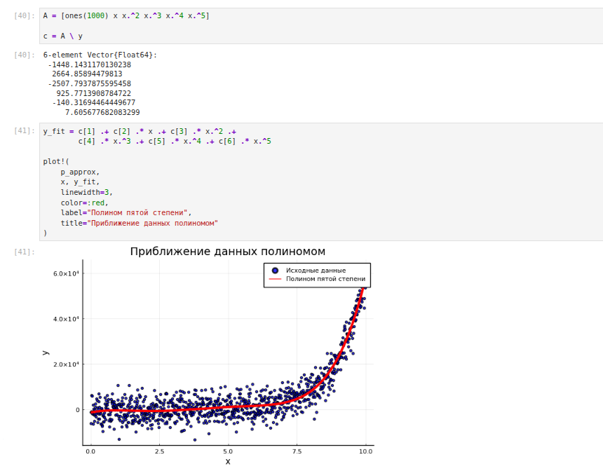
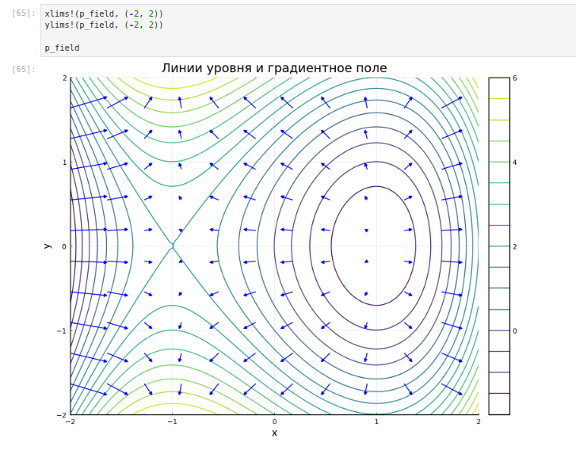
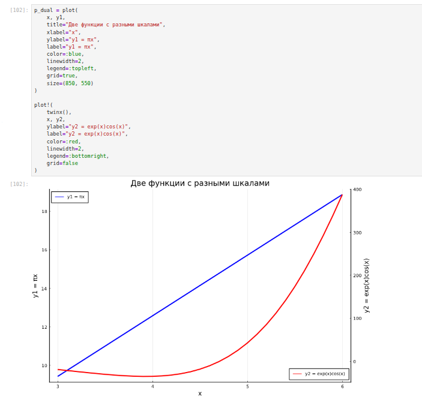
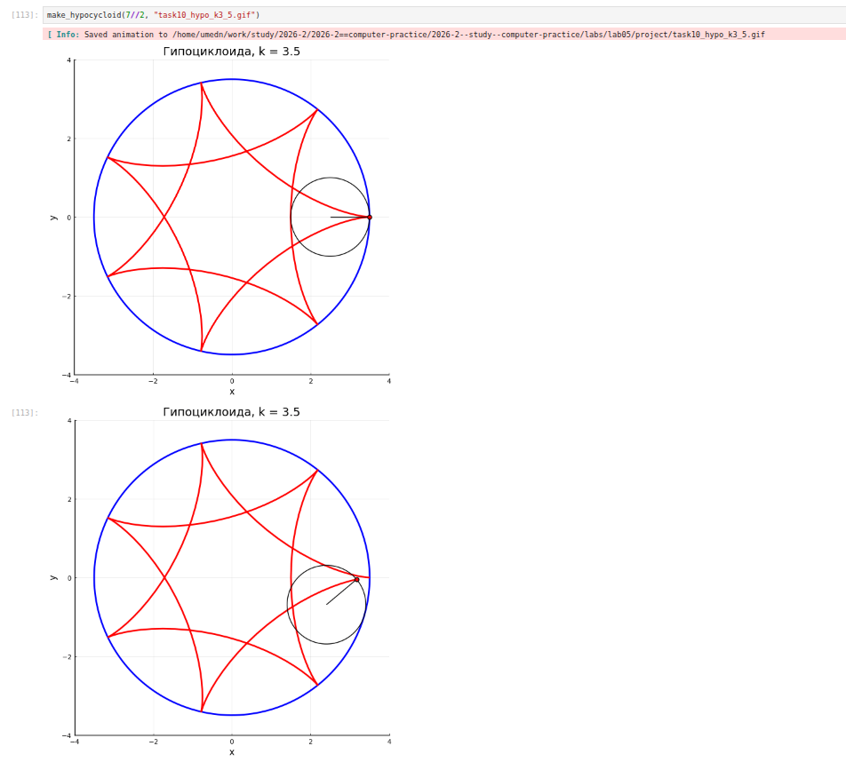

---
## Author
author:
  name: Умед Джамшедович Назармамадов
  affiliation:
    - name: Российский университет дружбы народов
      country: Российская Федерация
      postal-code: 117198
      city: Москва
      address: ул. Миклухо-Маклая, д. 6

## Title
title: Лабораторная работа №5
subtitle: Построение графиков
license: CC BY
date: today
date-format: "YYYY-MM-DD"
---

# Информация

## Докладчик

- Назармамадов Умед Джамшедович
- Студент группы НФИбд-02-23
- Факультет физико-математических и естественных наук
- Российский университет дружбы народов

::: notes
Здравствуйте! Меня зовут Назармамадов Умед.
Я представляю лабораторную работу номер пять, посвящённую построению графиков на языке Julia.
:::

# Вводная часть

## Актуальность

- Графики помогают исследовать поведение функций
- Визуализация позволяет сравнивать данные и замечать закономерности
- Julia поддерживает двумерные и трёхмерные графики, а также анимации

::: notes
Когда результатов вычислений много, по одним числам бывает сложно понять общую картину.
График помогает увидеть изменение функции, разброс данных и различия между несколькими зависимостями.
:::

## Объект и предмет исследования

- Объект: средства визуализации данных в Julia
- Предмет:
    - построение и оформление графиков
    - отображение случайных данных и погрешностей
    - создание подграфиков и анимаций

::: notes
В этой работе я изучал инструменты визуализации Julia.
Основное внимание уделял тому, как выбирать тип графика и задавать его параметры.
:::

## Цель и задачи

**Цель:** освоить синтаксис языка Julia для построения графиков.

**Задачи:**

- Повторить примеры методических указаний
- Настроить подписи осей, легенды и оформление
- Выполнить самостоятельные задания
- Создать анимации функций и кривых

::: notes
Цель работы состояла в освоении команд построения графиков.
Для этого я последовательно выполнял примеры, изменял оформление, а затем применял изученные команды в самостоятельных заданиях.
:::

## Материалы и методы

- WSL Ubuntu
- Julia и JupyterLab с ядром IJulia
- Пакеты: `Plots`, `PyPlot`, `UnicodePlots`
- Обработка данных: `Statistics`, `Distributions`
- Фиксация результатов: скриншоты и сохранённые изображения

::: notes
Работу я выполнял в JupyterLab с ядром Julia.
Для построения графиков использовал Plots, а для статистических вычислений и распределений подключал дополнительные пакеты.
:::

# Ход работы

## Основные команды построения

| Команда | Назначение |
|---------|------------|
| `plot()` | Создание графика |
| `plot!()` | Добавление к существующему графику |
| `scatter()` | Точечный график |
| `surface()` | Поверхность |
| `contour()` | Линии уровня |
| `savefig()` | Сохранение рисунка |

::: notes
Главное различие между plot и plot с восклицательным знаком заключается в том, что первая команда создаёт новый график, а вторая добавляет данные к существующему.
Для точек, поверхностей и линий уровня предусмотрены отдельные команды.
:::

## Графические механизмы

- GR: обычные графики
- PyPlot: использован для большинства построений
- Plotly: интерактивное представление
- UnicodePlots: график из текстовых символов

::: notes
Plots позволяет менять графический механизм, сохраняя похожие команды построения.
Я попробовал несколько вариантов. При выводе Plotly в Jupyter возникла проблема с отображением, поэтому использовал сохранение в HTML.
UnicodePlots позволил вывести график прямо текстовыми символами.
:::

## Синус и ряд Тейлора

$$
\sin(x)\approx
x-\frac{x^3}{3!}+\frac{x^5}{5!}
-\frac{x^7}{7!}+\frac{x^9}{9!}
$$

- Около нуля кривые практически совпадают
- При удалении от нуля отличие увеличивается
- Настроены стили линий, заливка, фон и отметки осей

::: notes
Я сравнил обычный синус с суммой пяти членов его ряда Тейлора.
Около нуля приближение хорошо совпадает с синусом, но ближе к краям выбранного отрезка различие становится заметнее.
На этом примере я также проверил параметры оформления.
:::

## Точечные графики и распределения

- Двумерные и трёхмерные случайные точки
- Размер и прозрачность маркеров
- Гистограммы случайных возрастов
- Нормальное распределение: среднее 35, стандартное отклонение 10

::: notes
Точечный график показывает отдельные наблюдения.
Я построил точки на плоскости и в пространстве, а также изменял размеры маркеров.
Гистограмма решает другую задачу: показывает, сколько значений попало в каждый интервал.
:::

## Приближение данных полиномом

- Исходные данные: экспонента со случайными отклонениями
- Приближение: полином пятой степени
- Коэффициенты: `c = A \ y`

{height=330px}

::: notes
Для этого примера я создал данные с общим ростом и случайным разбросом.
Затем подобрал полином пятой степени методом наименьших квадратов.
Красная линия повторяет общую тенденцию данных, хотя не проходит через каждую точку.
:::

## Полярные и параметрические графики

**Полярный график:**

$$
r(\theta)=1+\cos(\theta)\sin^2(\theta)
$$

**Кривая на плоскости:**

$$
x(t)=\sin(t),\qquad y(t)=\sin(2t)
$$

**Кривая в пространстве:**

$$
x(t)=\cos(t),\quad y(t)=\sin(t),\quad z(t)=\sin(5t)
$$

::: notes
В полярных координатах положение точки задаётся углом и расстоянием от центра.
В параметрическом представлении все координаты вычисляются через общий параметр t.
Так я построил восьмёрку на плоскости и кривую в пространстве.
:::

## Поверхности и линии уровня

- Поверхность: высота зависит от двух координат
- Каркас: поверхность изображается сеткой линий
- Мелкий шаг сетки делает изображение более гладким
- Линии уровня соединяют точки одинаковой высоты

::: notes
Сначала я построил поверхность x в квадрате плюс y в квадрате. Она имеет форму чаши.
Затем рассмотрел её каркас и уменьшил шаг сетки.
Линии уровня позволяют представить значения поверхности на плоскости, как на карте высот.
:::

## Градиентное поле

$$
h(x,y)=x^3-3x+y^2,
\qquad
\nabla h=(3x^2-3,\;2y)
$$

{height=380px}

::: notes
Для этой функции я вычислил производные по x и по y.
Они задают компоненты градиента.
Стрелки показывают направление наиболее быстрого увеличения функции.
Для удобства отображения я уменьшил их длину.
:::

## Две вертикальные шкалы

$$
y_1=\pi x,\qquad y_2=e^x\cos(x)
$$

- При общей шкале изменение первой функции плохо заметно
- `twinx()` добавляет отдельную правую ось

{height=340px}

::: notes
У этих функций сильно различаются диапазоны значений.
Поэтому на общей шкале первая линия кажется почти горизонтальной.
После добавления второй вертикальной оси изменение обеих функций стало хорошо видно.
При чтении такого рисунка нужно учитывать, к какой шкале относится каждая линия.
:::

## Погрешности и подграфики

**Неопределённость значений:**

- `yerror`, `xerror`: вертикальные и горизонтальные отрезки
- `ribbon`: цветная полоса вокруг линии

**Расположение графиков:**

- `layout=(2,2)`: сетка из четырёх графиков
- `grid`: настройка долей высоты
- `@layout`: сложные макеты

::: notes
Я рассмотрел несколько способов показать неопределённость: отдельные отрезки и цветную полосу.
Также научился объединять рисунки в одном окне.
Это удобно, когда нужно сравнить несколько вариантов представления данных.
:::

## Анимация синусоиды

- Подготовлены 120 точек на отрезке от 0 до $2\pi$
- Каждый кадр добавляет следующую точку
- Красный маркер показывает конец кривой
- Масштаб осей остаётся постоянным

::: notes
Принцип этой анимации простой: сначала показывается начало синусоиды, затем всё большая её часть.
Макрос animate формирует кадры, а команда gif объединяет их в файл.
Постоянный масштаб осей позволяет избежать изменения размера графика во время движения.
:::

## Гипоциклоиды и эпициклоиды

| Кривая | Движение маленькой окружности |
|--------|-------------------------------|
| Гипоциклоида | Внутри большой окружности |
| Эпициклоида | Снаружи большой окружности |

- Отношение радиусов: $k=R/r$
- Гипоциклоиды: $k=3,\;4,\;5/2,\;7/2$
- На скриншотах эпициклоид представлены $k=3,\;4$

::: notes
В обоих случаях кривую рисует точка на маленькой окружности.
Разница состоит в том, катится эта окружность внутри большой или снаружи.
Для гипоциклоид я получил четыре варианта.
В представленных материалах эпициклоиды показаны для двух целых значений отношения радиусов.
:::

## Влияние отношения радиусов

{height=430px}

::: notes
При дробном отношении радиусов получается более сложная кривая с самопересечениями.
Для значения семь вторых потребовалось два оборота центра маленькой окружности, чтобы кривая замкнулась.
В программе число оборотов определяется знаменателем точной дроби.
:::

# Результаты

## Что получено

- Построены графики функций и случайных данных
- Настроены подписи, легенды, цвета и стили
- Рассмотрены поверхности, линии уровня и векторные поля
- Реализованы макеты подграфиков и формирование анимаций
- Подтверждено сохранение четырёх гипоциклоид и двух эпициклоид

::: notes
В результате я познакомился с основными средствами визуализации Julia.
Теперь могу выбрать подходящий тип графика, добавить оформление, объединить несколько рисунков и сформировать анимацию.
:::

## Ограничения и доработка

- PyPlot не поддержал стиль `:dashdotdot`
- Plotly не показал график непосредственно в ноутбуке
- Пример с шестью типами подграфиков требует исправления
- Нужно добавить результаты эпициклоид при $k=5/2$ и $k=7/2$

::: notes
В ходе работы выяснилось, что поддержка параметров зависит от графического механизма.
Например, стиль с двумя точками PyPlot не поддержал.
Для полного завершения нужно также исправить один пример с подграфиками и дополнить результаты двух дробных эпициклоид.
:::

# Заключение

## Главный вывод

Средства Julia позволяют наглядно представлять функции и данные.

Выбор типа графика, масштаба и оформления влияет на то, насколько легко понять результат.

::: notes
Главный вывод работы состоит в том, что важно не только построить график, но и правильно выбрать способ отображения.
Подписи, масштаб и легенда помогают понять, что именно показано на рисунке.
Спасибо за внимание! Я готов ответить на вопросы.
:::