---
## Author
author:
  name: Умед Джамшедович Назармамадов
  affiliation:
    - name: Российский университет дружбы народов
      country: Российская Федерация
      postal-code: 117198
      city: Москва
      address: ул. Миклухо-Маклая, д. 6

title: "Отчёт по лабораторной работе №5"
subtitle: "Построение графиков"
abstract: |
  В работе рассмотрены средства построения графиков на языке Julia.
  Выполнены примеры использования пакета Plots и различных графических
  механизмов. Построены двумерные и трёхмерные графики, поверхности,
  линии уровня, векторные поля и гистограммы. Рассмотрены способы
  оформления графиков, отображения погрешностей и создания анимаций.
keywords: [Julia, Plots, графики, визуализация, анимация]
---

# Введение

## Актуальность

Графическое представление данных позволяет наглядно исследовать поведение функций, сравнивать результаты вычислений и выявлять закономерности. Средства визуализации применяются при статистическом анализе, математическом моделировании и обработке экспериментальных данных.

В языке Julia доступны инструменты для построения графиков различных типов, настройки их оформления и создания анимаций.

## Цель работы

Освоить синтаксис языка Julia для построения графиков.

## Задачи

1. Повторить примеры из раздела 5.2 методических указаний.
2. Дополнить графики названиями, подписями осей и легендами.
3. Изучить построение точечных графиков, поверхностей, линий уровня и векторных полей.
4. Рассмотреть отображение погрешностей измерений и распределений случайных величин.
5. Изучить объединение нескольких графиков в одном окне.
6. Выполнить задания для самостоятельной работы из раздела 5.4.
7. Создать анимации синусоиды и кривых, связанных с качением окружностей.

## Объект и предмет исследования

Объект исследования: средства графического представления данных в Julia.

Предмет исследования: команды построения и оформления графиков, отображения случайных данных и создания анимаций.

## Методы исследования

В работе использовались вычислительные эксперименты в JupyterLab, построение графиков функций, генерация случайных данных и визуальное сравнение результатов.

## Схема выполнения работы

Работа выполнялась в следующем порядке:

1. Подготовка рабочего окружения и подключение пакетов.
2. Последовательное выполнение примеров методических указаний.
3. Построение графиков с дополнительным оформлением.
4. Выполнение самостоятельных заданий.
5. Сохранение результатов и подготовка отчёта.

# Теоретическая часть

## Средства построения графиков

Пакет `Plots` предоставляет общий интерфейс для построения графиков. Для непосредственного отображения используются графические механизмы, в том числе GR, PyPlot и Plotly.

Команда `plot()` создаёт новый график. Команда `plot!()` добавляет данные к существующему графику.

Основные параметры оформления приведены в @tbl-options.

| Параметр | Назначение |
|---|---|
| `title` | Название графика |
| `xlabel`, `ylabel`, `zlabel` | Подписи координатных осей |
| `label` | Подпись серии данных в легенде |
| `color` | Цвет |
| `linewidth` | Толщина линии |
| `linestyle` | Стиль линии |
| `markersize` | Размер маркеров |
| `alpha` | Прозрачность |
| `layout` | Расположение подграфиков |
| `size` | Размер графического окна |

: Основные параметры оформления графиков {#tbl-options}

Для сохранения рисунка используется команда `savefig()`.

## Типы графиков

Линейный график показывает изменение величины и соединяет точки отрезками. Точечный график отображает отдельные наблюдения без соединения линиями.

Гистограмма показывает количество наблюдений, попавших в заданные интервалы.

Поверхность представляет зависимость одной величины от двух переменных. Линии уровня соединяют точки, в которых функция принимает одинаковое значение.

Векторное поле изображается стрелками. Для функции двух переменных её градиент имеет вид

$$
\nabla h(x,y)=
\left(
\frac{\partial h}{\partial x},
\frac{\partial h}{\partial y}
\right).
$$

Градиент направлен в сторону наиболее быстрого увеличения функции.

## Анимация

Анимация представляет последовательность кадров. При изменении параметров функции или количества отображаемых точек на каждом кадре получается движущееся изображение.

В пакете `Plots` кадры можно сформировать с помощью `@animate`, а затем сохранить командой `gif()`.

# Материалы и методы

Работа выполнялась в среде WSL Ubuntu с использованием Julia и JupyterLab с ядром IJulia.

Применялись следующие пакеты:

- `Plots` для построения графиков;
- `PyPlot` для графического отображения;
- `UnicodePlots` для текстового представления графика;
- `Statistics` для расчёта средних значений и стандартных отклонений;
- `Distributions` для генерации данных с заданным распределением.

Результаты выполнения фиксировались скриншотами. При случайной генерации данных конкретное расположение точек и высота столбцов могут изменяться при повторном запуске.

# Выполнение лабораторной работы

## Основные пакеты для работы с графиками

В начале работы был подключён менеджер пакетов `Pkg` и выполнена установка `Plots`. Подготовка пакета представлена на @fig-002.

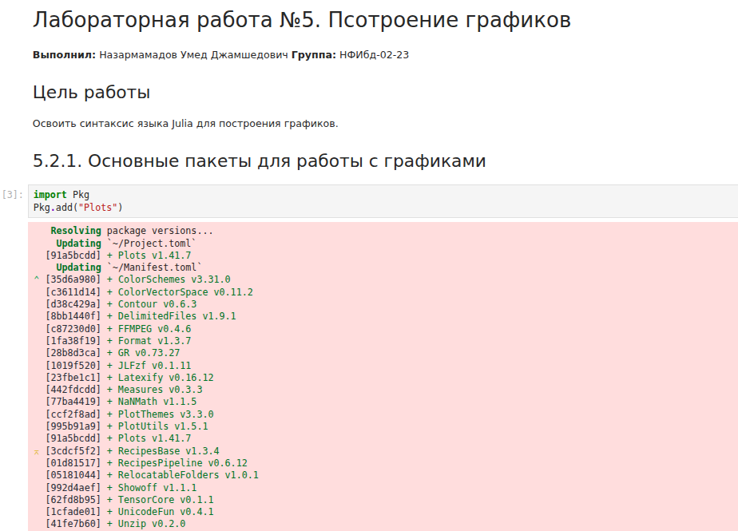{#fig-002 width=90%}

Для первого графика использовалась функция

$$
f(x)=(3x^2+6x-9)e^{-0.3x}.
$$

Значения аргумента задавались на отрезке от −5 до 10 с шагом 0.1. Значения функции вычислялись поэлементно с помощью `f.(x)`.

Сначала график был построен с английскими подписями осей и легендой (@fig-004).

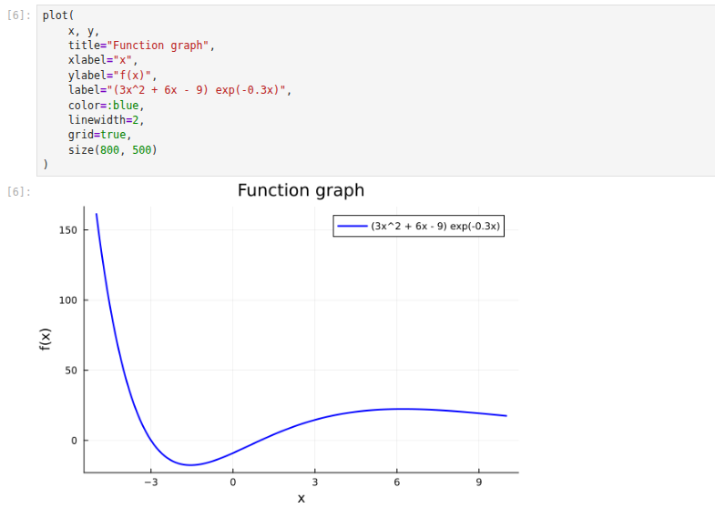{#fig-004 width=90%}

Затем был построен вариант с русскими подписями (@fig-005). Форма кривой сохранилась.

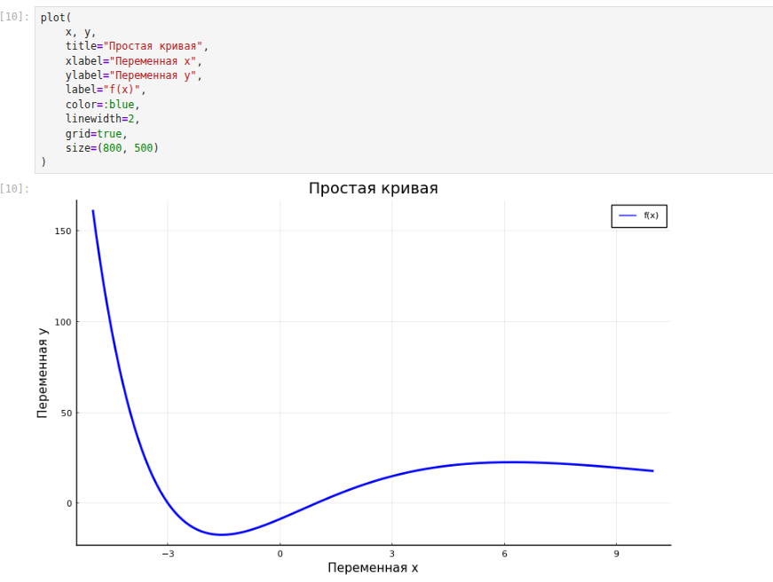{#fig-005 width=90%}

При использовании Plotly график не отобразился непосредственно в выводе ноутбука. Поэтому в код была добавлена команда сохранения в HTML. На @fig-006 показан результат сохранения файла.

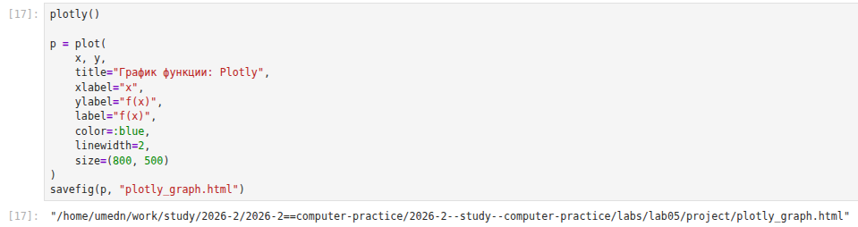{#fig-006 width=95%}

Для текстового представления использовалась функция `UnicodePlots.lineplot()`. Результат был выведен через `show` с форматом `text/plain` (@fig-007).

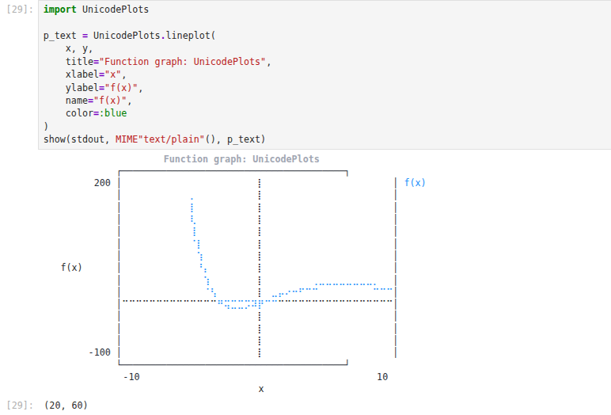{#fig-007 width=90%}

## Опции при построении графика

Для исследования оформления сравнивались функция $\sin(x)$ и сумма первых пяти членов её ряда Тейлора:

$$
S_9(x)=x-\frac{x^3}{3!}+\frac{x^5}{5!}
-\frac{x^7}{7!}+\frac{x^9}{9!}.
$$

Обе функции были построены на отрезке $[-5,5]$. При совместном отображении видно, что около нуля кривые практически совпадают, а при удалении от нуля различие увеличивается (@fig-010).

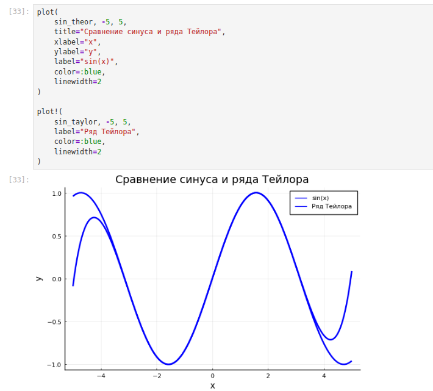{#fig-010 width=90%}

Затем были настроены толщина, прозрачность и стиль линий, цвет фона, заливка, шрифты и отметки на осях. Результат представлен на @fig-011.

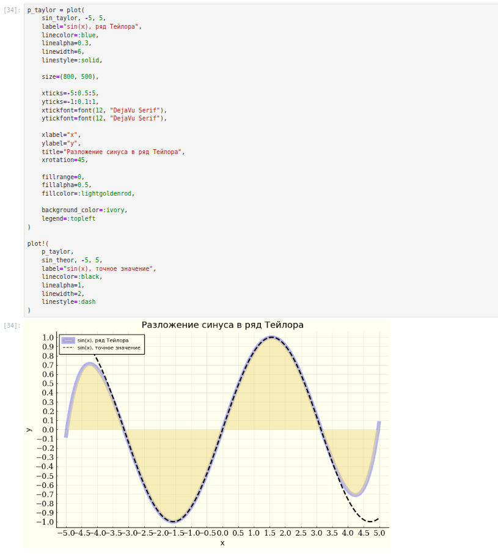{#fig-011 width=90%}

## Точечные графики

Сначала были созданы десять случайных значений и построен простой точечный график (@fig-012).

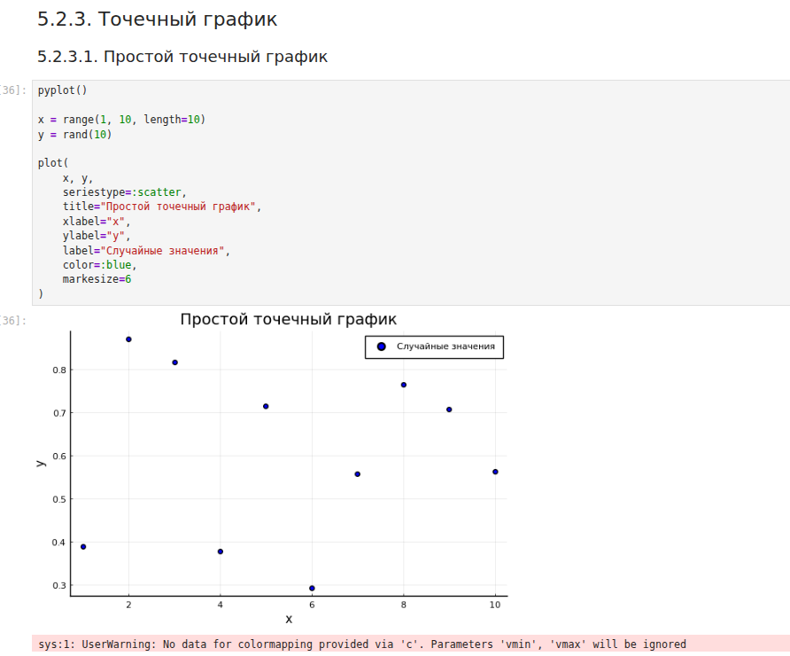{#fig-012 width=90%}

Затем были созданы 50 точек со случайными координатами и размерами маркеров (@fig-013).

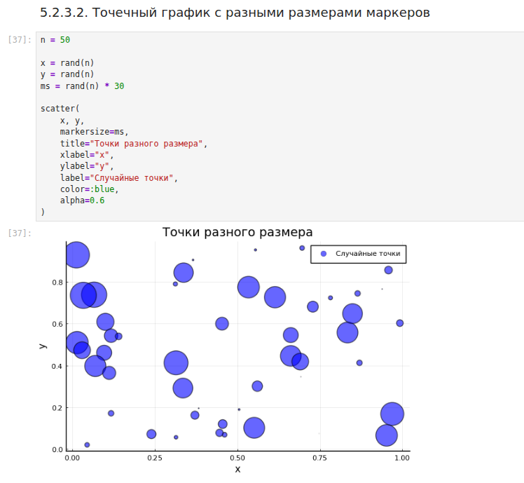{#fig-013 width=90%}

После добавления третьей координаты был построен трёхмерный точечный график (@fig-014).

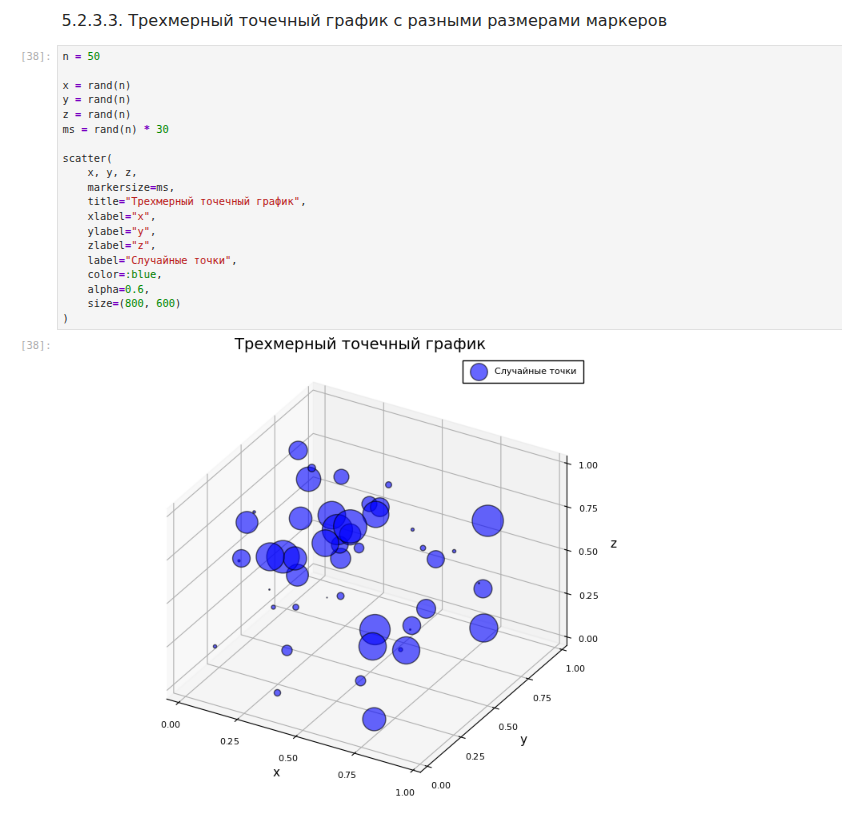{#fig-014 width=90%}

## Аппроксимация

Для исследования аппроксимации были сформированы значения экспоненциальной функции со случайными отклонениями.

Приближение выполнялось полиномом пятой степени:

$$
p(x)=c_1+c_2x+c_3x^2+c_4x^3+c_5x^4+c_6x^5.
$$

Для определения коэффициентов была сформирована матрица

$$
A=
\begin{pmatrix}
1 & x_1 & x_1^2 & x_1^3 & x_1^4 & x_1^5\\
1 & x_2 & x_2^2 & x_2^3 & x_2^4 & x_2^5\\
\vdots & \vdots & \vdots & \vdots & \vdots & \vdots
\end{pmatrix}.
$$

Команда `c = A \ y` определяет коэффициенты методом наименьших квадратов. Полученный полином был добавлен к исходным точкам (@fig-016).

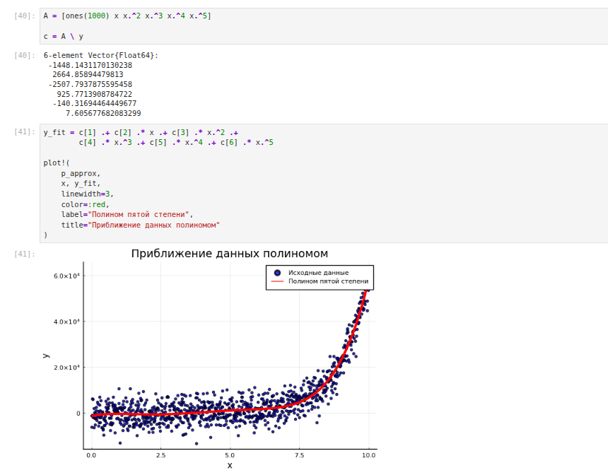{#fig-016 width=95%}

Красная кривая передаёт общую тенденцию роста данных, не проходя через каждую случайную точку.

## Две оси ординат

Были созданы две случайные последовательности с различными масштабами значений. Для второй последовательности использовалось умножение на 10.

С помощью `twinx()` к графику была добавлена правая вертикальная ось (@fig-018).

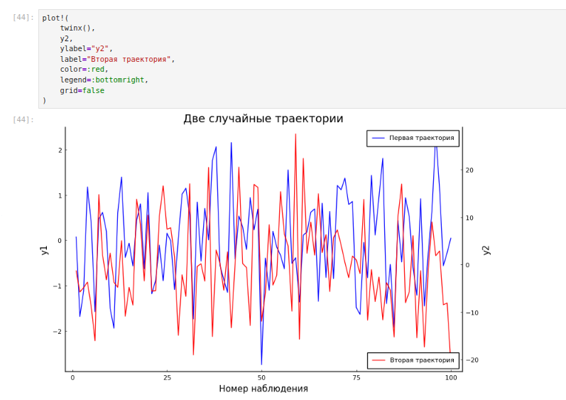{#fig-018 width=90%}

Синяя линия соответствует левой шкале, красная правой.

## Полярные координаты

В полярной системе координат была построена функция

$$
r(\theta)=1+\cos(\theta)\sin^2(\theta),
\qquad 0\leq\theta\leq2\pi.
$$

Для выбора полярной системы использовался параметр `proj=:polar`. Результат представлен на @fig-019.

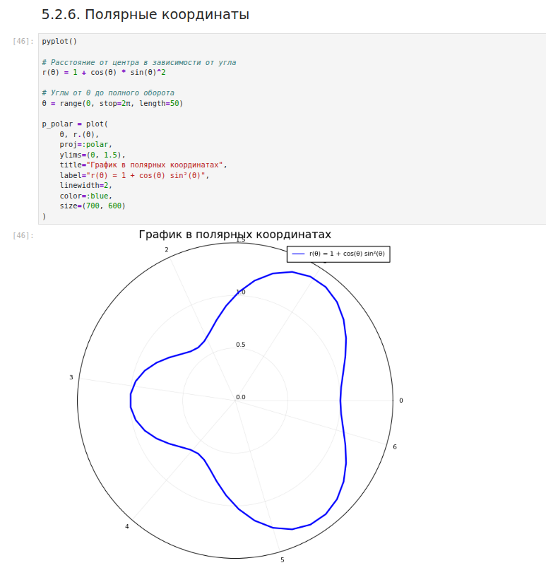{#fig-019 width=85%}

## Параметрические графики

На плоскости была построена кривая

$$
x(t)=\sin(t),\qquad
y(t)=\sin(2t),\qquad
0\leq t\leq2\pi.
$$

Полученная кривая имеет форму восьмёрки (@fig-020).

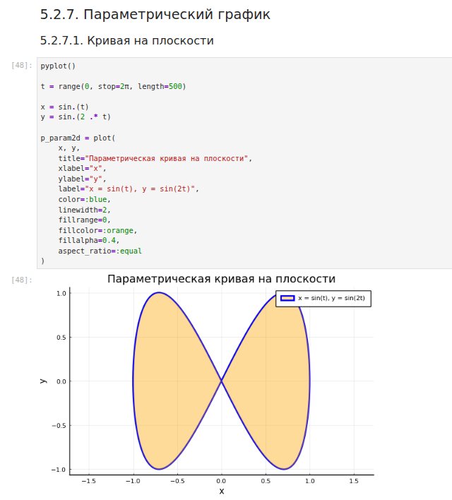{#fig-020 width=90%}

В пространстве использовались зависимости

$$
x(t)=\cos(t),\qquad
y(t)=\sin(t),\qquad
z(t)=\sin(5t),\qquad
0\leq t\leq10.
$$

Результат показан на @fig-021.

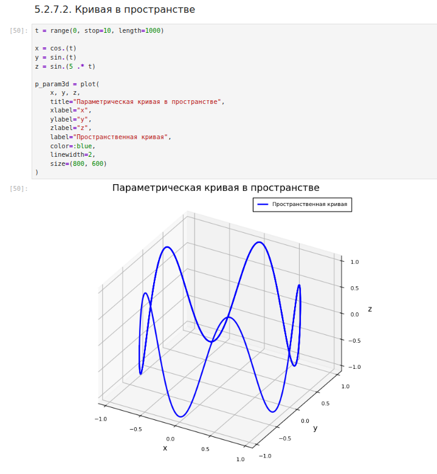{#fig-021 width=90%}

## Графики поверхностей

Была построена поверхность

$$
z=x^2+y^2.
$$

При использовании `surface()` получен параболоид (@fig-022).

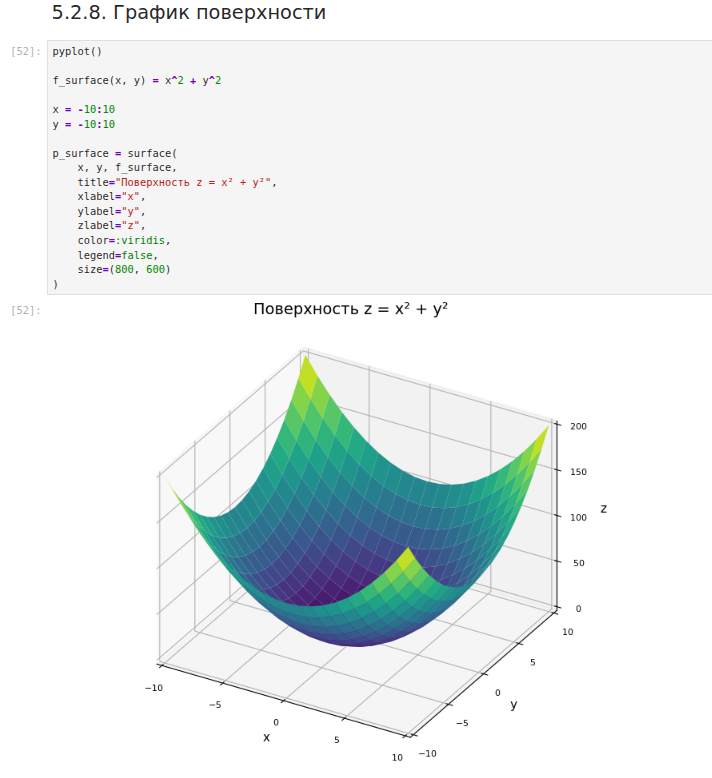{#fig-022 width=90%}

Также был построен каркас поверхности с помощью `wireframe()` (@fig-024).

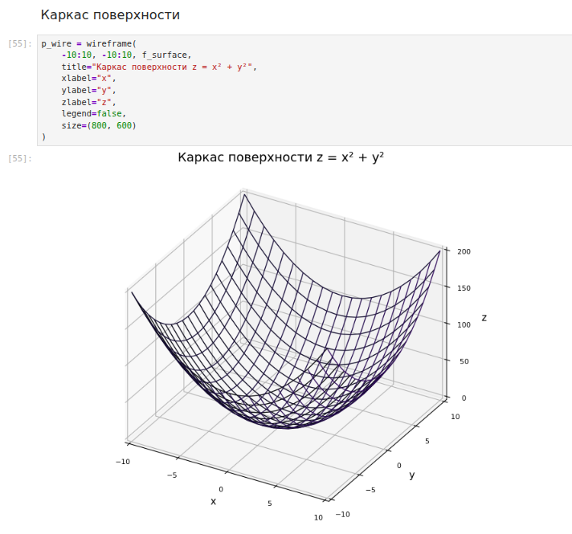{#fig-024 width=90%}

Уменьшение шага сетки с 1 до 0.1 позволило получить более гладкое изображение (@fig-025).

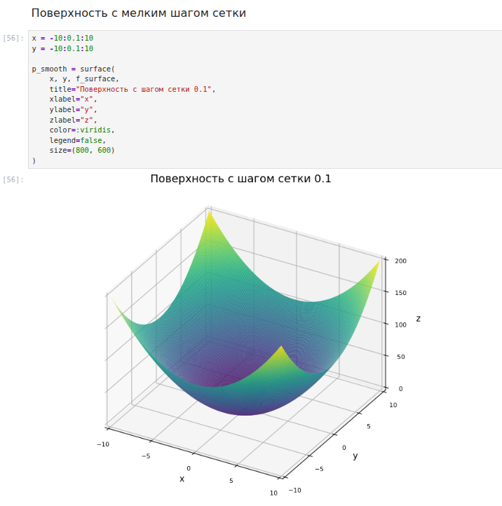{#fig-025 width=90%}

Для функции

$$
z=xy-x-y+1
$$

были изменены цветовая палитра и направление обзора с помощью параметра `camera` (@fig-026).

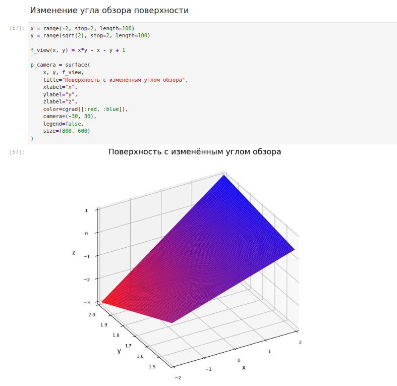{#fig-026 width=90%}

## Линии уровня

Рассматривалась функция

$$
g(x,y)=(3x+y^2)|\sin(x)+\cos(y)|.
$$

Сначала была построена её поверхность (@fig-027).

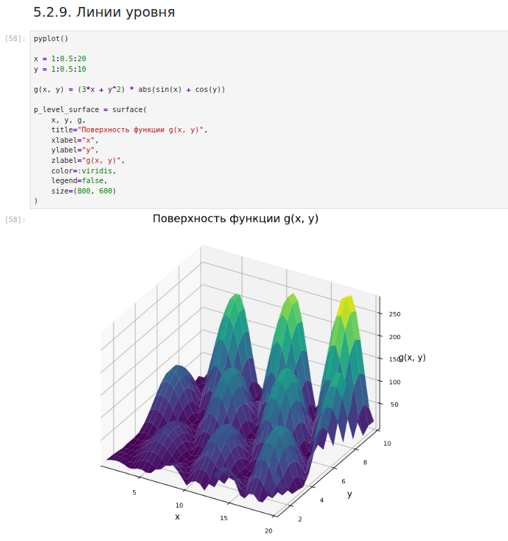{#fig-027 width=90%}

Затем с помощью `contour()` были построены линии уровня (@fig-028).

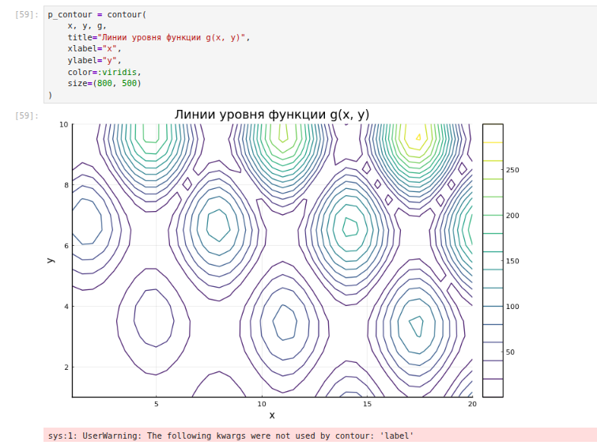{#fig-028 width=90%}

При добавлении параметра `fill=true` области между уровнями были заполнены цветом (@fig-029).

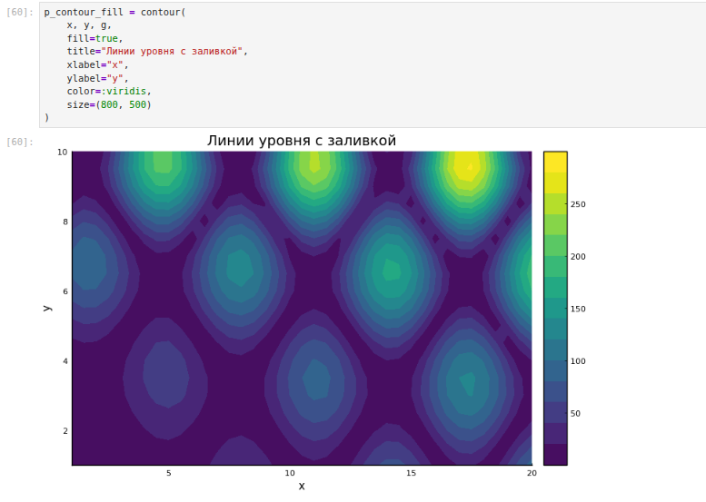{#fig-029 width=90%}

Цветовая шкала позволяет сопоставить области рисунка со значениями функции.

## Векторные поля

Для функции

$$
h(x,y)=x^3-3x+y^2
$$

были построены поверхность и линии уровня. Затем было добавлено градиентное поле:

$$
\nabla h(x,y)=(3x^2-3,\;2y).
$$

Для отображения стрелок использовалась команда `quiver!()`. Компоненты векторов делились на 25 для уменьшения их длины.

После ограничения области видимости получен результат, представленный на @fig-034.

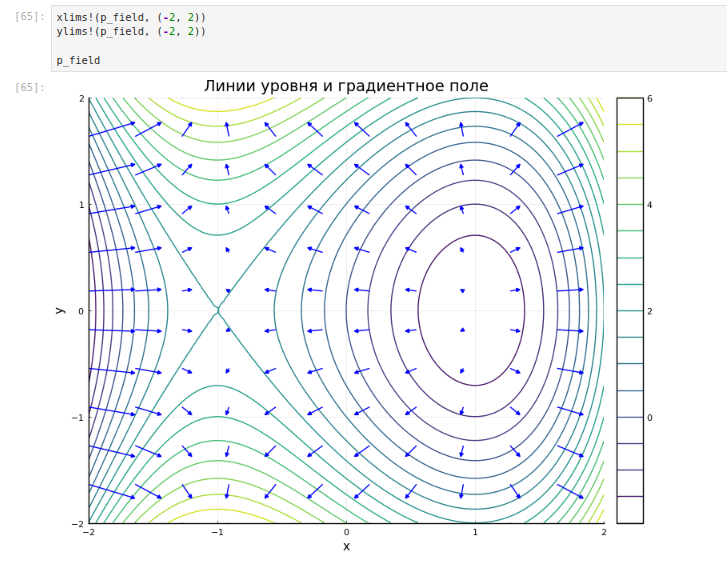{#fig-034 width=90%}

Стрелки показывают направление увеличения функции.

## Анимация поверхности

Для создания анимации использовалась поверхность

$$
z=\sin(x+10\sin(\varphi))+\cos(y).
$$

Параметр $\varphi$ изменялся от 0 до $2\pi$. Сначала был построен неподвижный график (@fig-035).

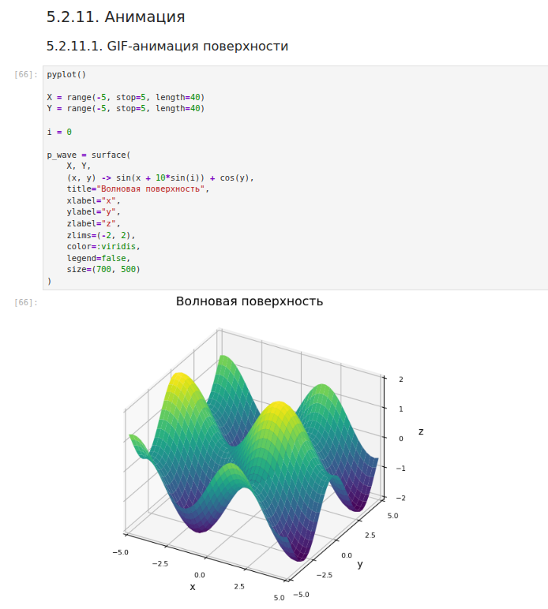{#fig-035 width=90%}

Затем с помощью `@animate` была сформирована последовательность из 100 кадров (@fig-036).

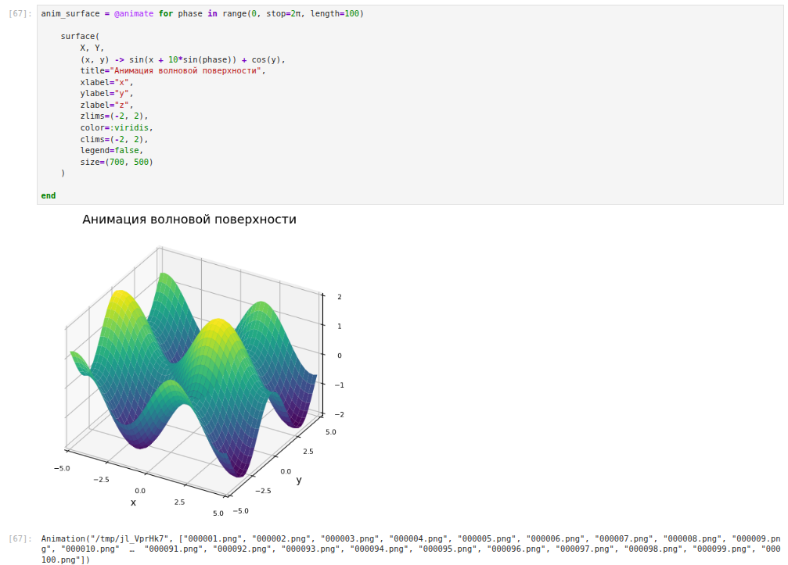{#fig-036 width=95%}

В представленном скриншоте показан объект анимации и один из кадров. Проверка воспроизведения GIF требует самого файла анимации.

## Построение гипоциклоиды

Гипоциклоида описывает движение точки окружности, которая катится по внутренней стороне другой окружности.

Для радиусов $R$ и $r$ и отношения $k=R/r$ использовались формулы

$$
x(t)=(R-r)\cos(t)+r\cos((k-1)t),
$$

$$
y(t)=(R-r)\sin(t)-r\sin((k-1)t).
$$

Была построена большая окружность, затем добавлена часть гипоциклоиды (@fig-039).

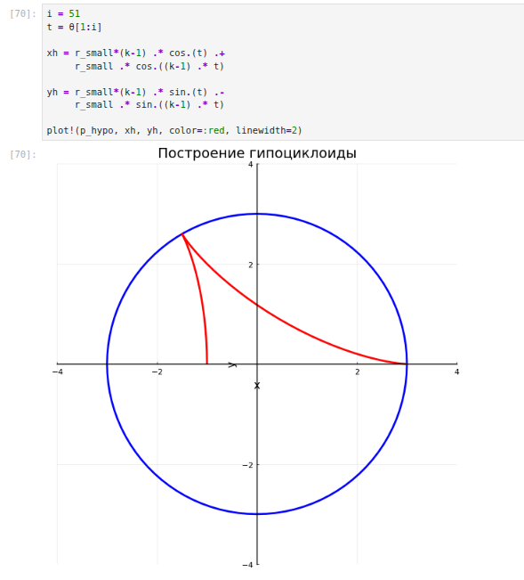{#fig-039 width=85%}

При первоначальном построении вспомогательной окружности были допущены ошибки в вычислении её центра. Поэтому на промежуточных изображениях вспомогательная окружность и радиус отображались некорректно.

Корректное построение центра и движущейся окружности было реализовано позднее в функции `make_hypocycloid`, использованной в самостоятельном задании 10.

## Погрешности измерений

Были сгенерированы выборки с различными стандартными отклонениями. Для каждой выборки вычислялось среднее значение.

Полуширина приблизительного интервала рассчитывалась по формуле

$$
\Delta=1.96\frac{\sigma}{\sqrt{n}},
$$

где $\sigma$ является заданным стандартным отклонением, а $n$ размером выборки.

Вертикальные интервалы были построены с помощью `yerror` (@fig-044).

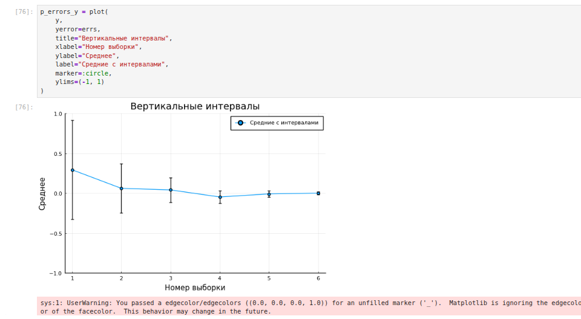{#fig-044 width=90%}

Горизонтальные интервалы задавались параметром `xerror` (@fig-045).

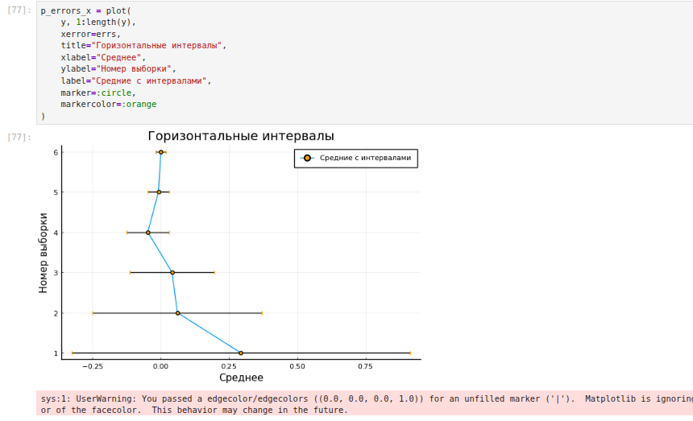{#fig-045 width=90%}

Параметр `ribbon` использовался для отображения неопределённости в виде цветной полосы (@fig-046).

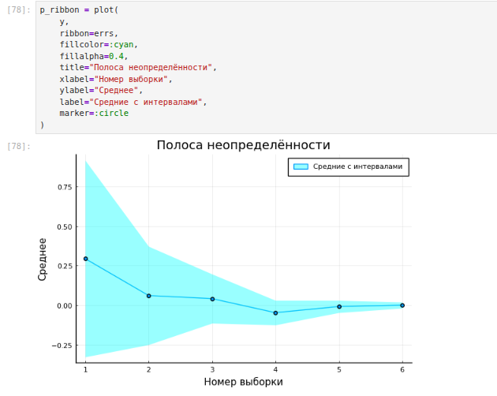{#fig-046 width=90%}

Для пяти групп наблюдений были вычислены средние значения и приближённые интервалы по обеим координатам (@fig-047).

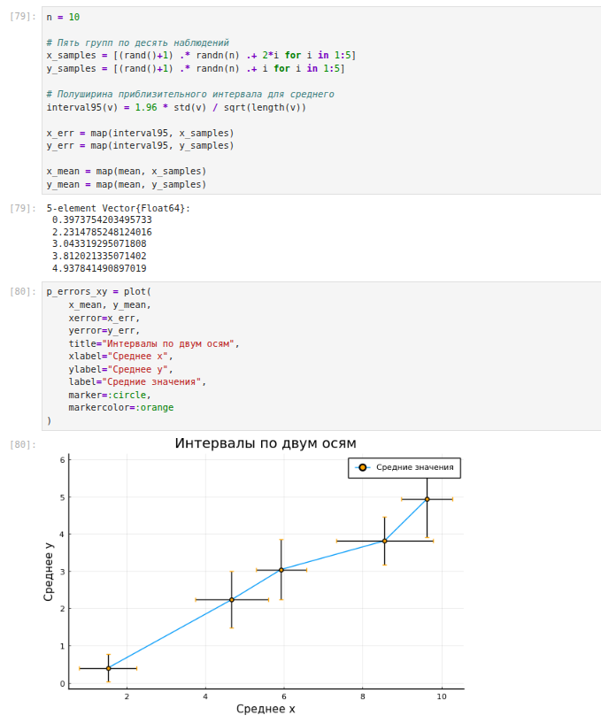{#fig-047 width=90%}

Также был рассмотрен вариант асимметричного отображения интервалов (@fig-048). Длины в отрицательную и положительную стороны задавались отдельно.

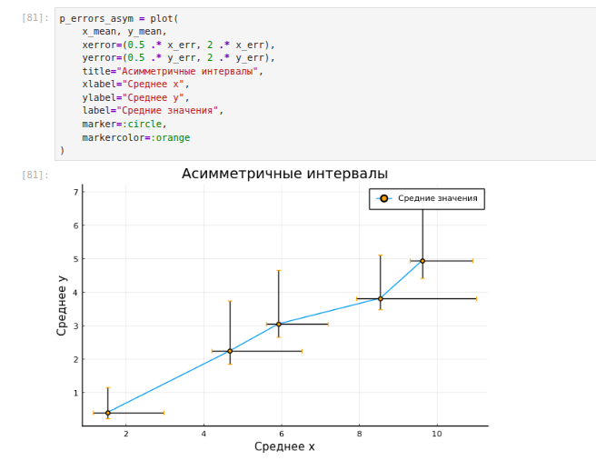{#fig-048 width=90%}

## Использование пакета Distributions

Сначала была построена гистограмма 1000 случайных целых значений возраста от 15 до 55 (@fig-049).

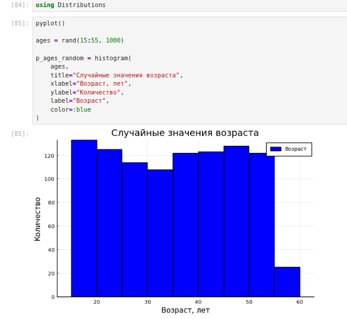{#fig-049 width=90%}

Затем использовалось нормальное распределение со средним 35 и стандартным отклонением 10 (@fig-050).

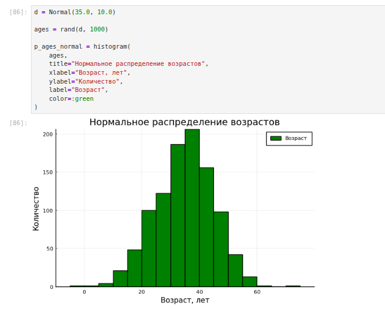{#fig-050 width=90%}

Дополнительно были объединены три выборки из нормальных распределений со средними 10, 35 и 60. Полученный массив содержит 1834 значения.

Для смеси была вызвана команда построения гистограммы через Plotly (@fig-052). На представленном скриншоте виден код построения, но отсутствует изображение результата.

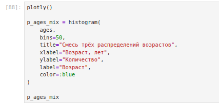{#fig-052 width=90%}

Сгенерированные возраста используются как учебные данные. Нормальное распределение не ограничено реалистичным диапазоном возрастов.

## Подграфики

Для четырёх серий данных были рассмотрены различные способы расположения графиков.

При `layout=(4,1)` графики размещались друг под другом (@fig-053).

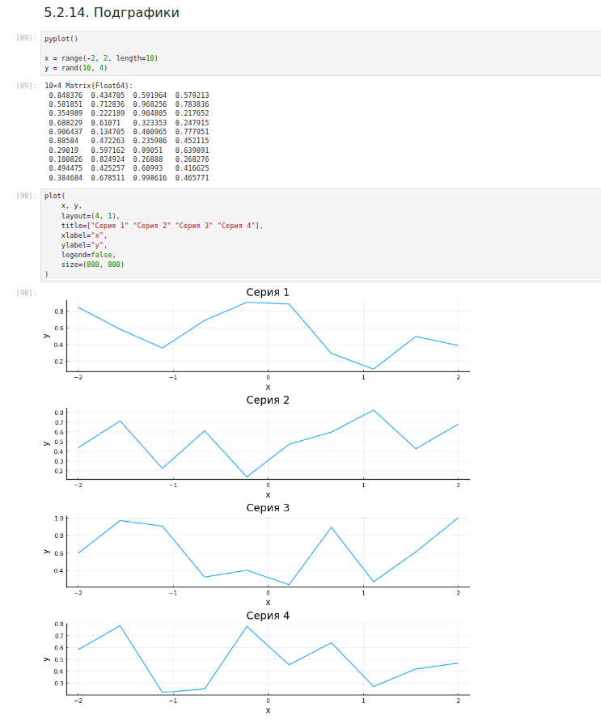{#fig-053 width=85%}

При `layout=4` автоматически формировалась сетка 2 × 2 (@fig-054).

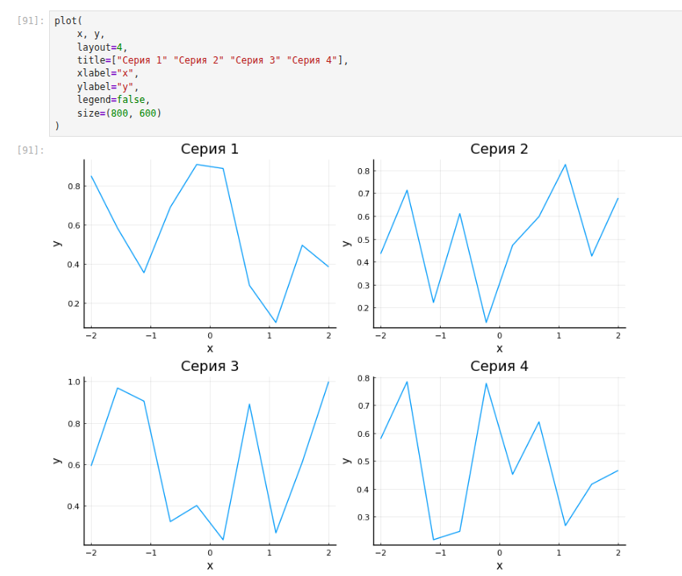{#fig-054 width=90%}

С помощью `grid` были заданы разные доли высоты подграфиков. Использовались значения 0.15, 0.25, 0.4 и 0.2, сумма которых равна единице.

Затем в одном окне были объединены линейный график, точечный график, две серии линий и гистограммы (@fig-056).

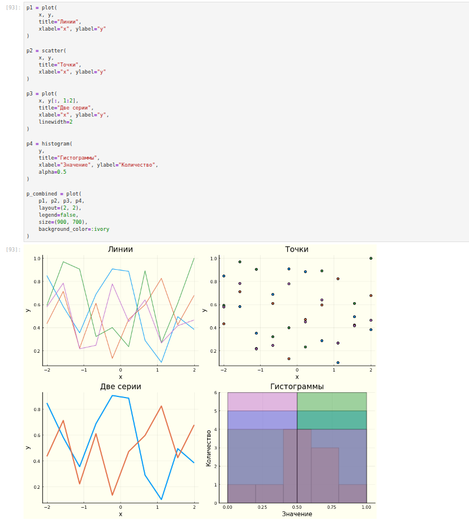{#fig-056 width=90%}

В отдельном примере с шестью типами представления данных фактически заполнился только первый подграфик. Этот пример требует корректировки распределения данных по подграфикам.

Для сложного макета использовался макрос `@layout`. Были размещены 11 подграфиков различного размера (@fig-058).

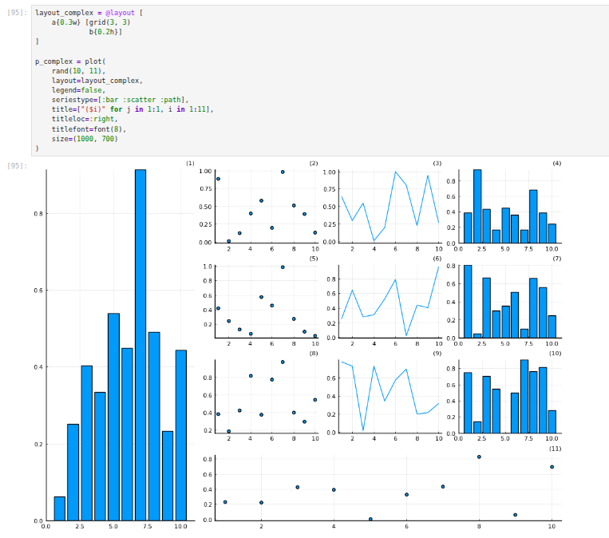{#fig-058 width=95%}

# Самостоятельные задания

## Задание 1. Типы графиков функции sin(x)

На отрезке $[0,2\pi]$ были вычислены значения функции $\sin(x)$.

В одном окне построены:

1. Линейный график.
2. Точечный график.
3. Линия с маркерами.
4. Столбчатый график.
5. Стержневой график.
6. Ступенчатый график.
7. График с заливкой.
8. Гистограмма значений функции.

Результат представлен на @fig-060.

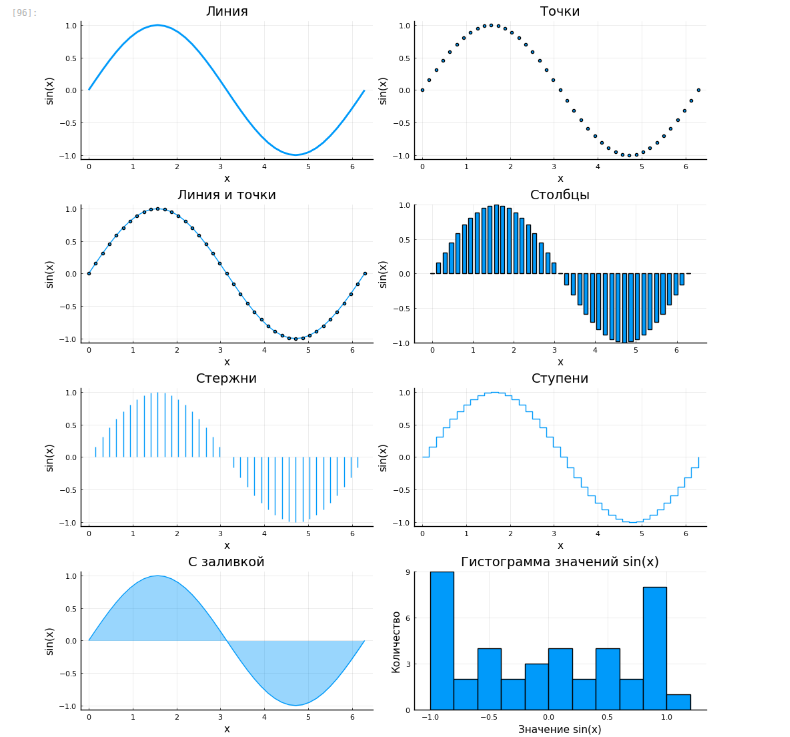{#fig-060 width=95%}

Первые семь подграфиков показывают зависимость от аргумента. Гистограмма показывает распределение вычисленных значений синуса по интервалам.

## Задание 2. Стили линий

Для функции $\sin(x)$ были заданы сплошной, штриховой, точечный и штрихпунктирный стили.

Также была предпринята попытка использования `:dashdotdot`. Графический механизм PyPlot сообщил, что данный стиль не поддерживается. Поэтому пятый график нельзя считать отдельным успешно отображённым стилем (@fig-061).

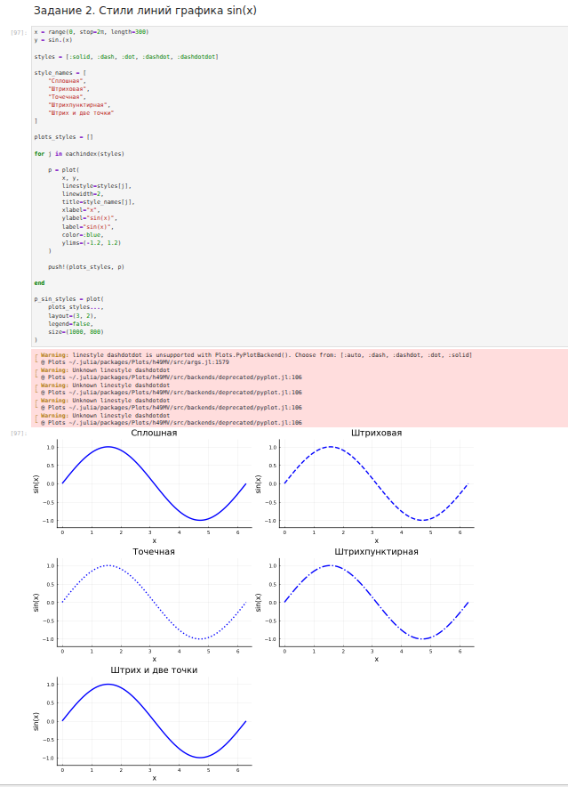{#fig-061 width=95%}

## Задание 3. Оформление графика

Была построена функция

$$
y=\pi x^2\ln(x),\qquad x>0.
$$

Для вычислений использовался диапазон от 0.1 до 3. Были настроены красный цвет линии, зелёный цвет рамки, шрифты, отметки на осях и поля рисунка (@fig-062).

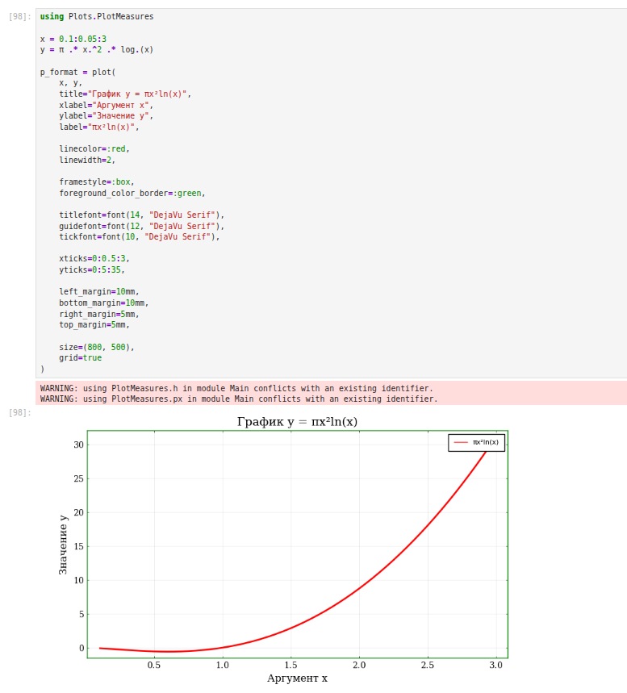{#fig-062 width=95%}

Увеличение полей позволило разместить подписи осей в пределах изображения.

## Задание 4. Четыре способа изображения функции

Для вектора

$$
x=(-2,-1,0,1,2)
$$

были вычислены значения функции

$$
y=x^3-3x.
$$

Получены значения

$$
y=(-2,2,0,-2,2).
$$

В четырёх подокнах были построены точки, ломаная, ломаная с маркерами и плавная кривая (@fig-064).

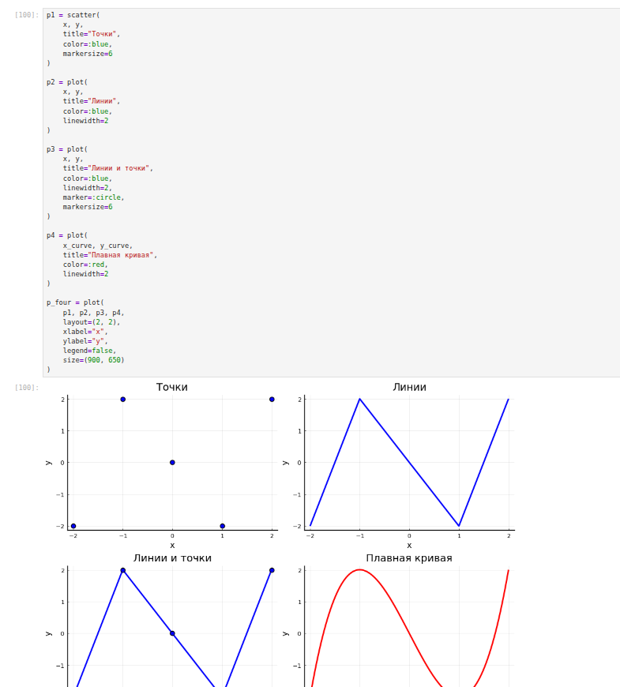{#fig-064 width=95%}

Для плавной кривой использовались 300 значений аргумента. При построении ломаной использовались только пять заданных точек.

В коде было предусмотрено сохранение результата в файл `figure_nazarmamadov.png`.

## Задание 5. Функции с различными масштабами

На отрезке от 3 до 6 с шагом 0.1 были построены функции

$$
y_1=\pi x,\qquad y_2=e^x\cos(x).
$$

Сначала использовалась общая вертикальная шкала (@fig-065).

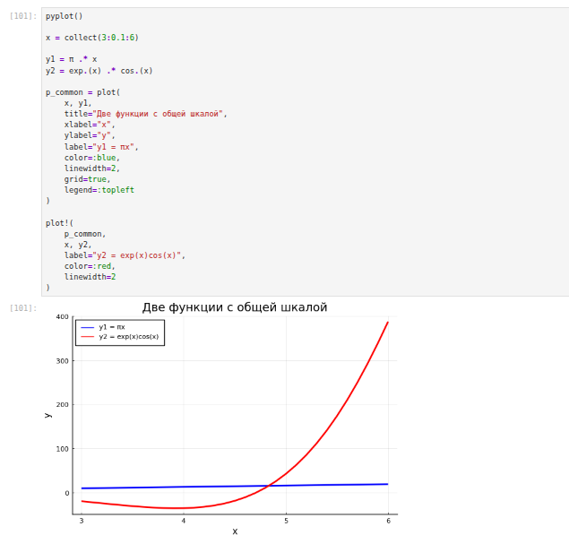{#fig-065 width=90%}

Недостатком такого представления является слабая заметность изменения первой функции на фоне значительно большего диапазона второй.

Затем для второй функции была добавлена отдельная правая ось (@fig-066).

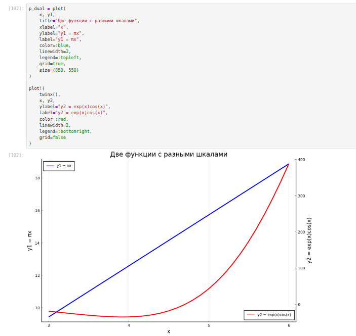{#fig-066 width=90%}

Такое представление позволяет рассмотреть изменение обеих функций. При этом значения каждой линии необходимо читать по соответствующей шкале.

## Задание 6. Данные с погрешностью измерения

Был составлен учебный набор данных о нагревании воды. Значения температуры увеличивались от 20 до 46 °C за пять минут.

Для каждой точки задавалась погрешность ±1 °C (@fig-067).

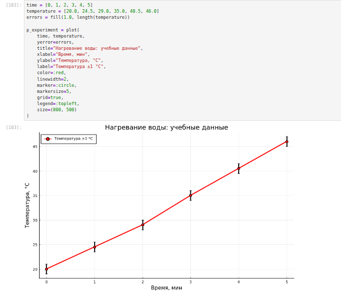{#fig-067 width=90%}

Данные являются придуманным примером и не представляют результаты реального физического эксперимента.

## Задание 7. Случайные точки на плоскости

Были созданы два массива по 100 случайных чисел из диапазона от 0 до 1.

Для точечного графика заданы название, подписи осей, легенда, цвет и прозрачность маркеров (@fig-068).

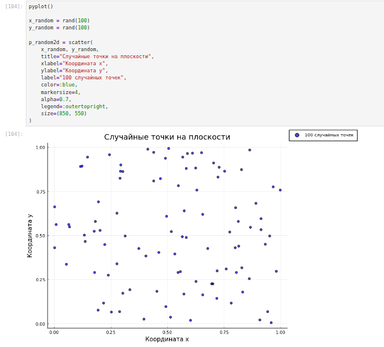{#fig-068 width=90%}

## Задание 8. Случайные точки в пространстве

Были созданы три массива по 100 случайных значений. Каждая точка задавалась тремя координатами.

Получен трёхмерный точечный график с подписями осей и легендой (@fig-069).

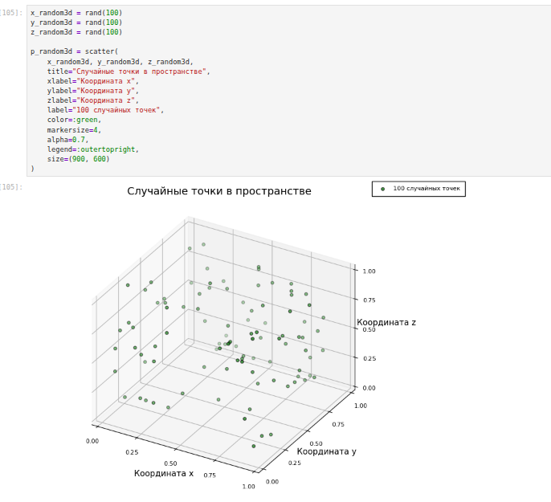{#fig-069 width=90%}

## Задание 9. Анимация синусоиды

Для функции $\sin(x)$ на отрезке $[0,2\pi]$ были подготовлены 120 точек.

На каждом кадре отображались значения от начала массива до текущего индекса. Красный маркер обозначал конец строящейся кривой.

Формирование кадров представлено на @fig-071.

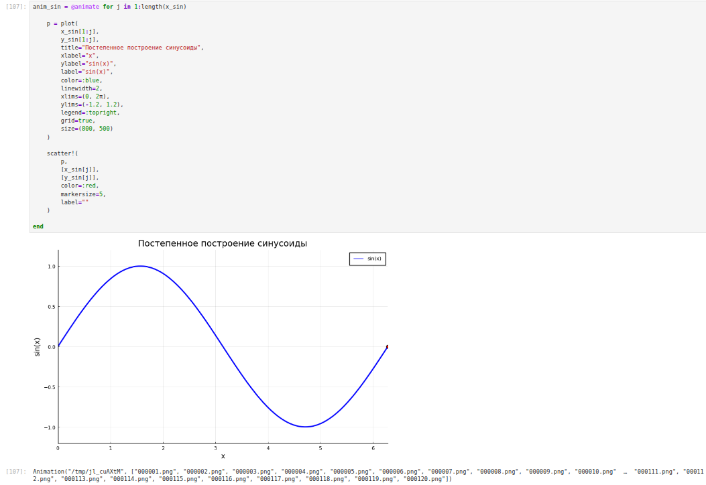{#fig-071 width=95%}

Пределы осей оставались постоянными на всех кадрах. В коде было предусмотрено сохранение анимации в `task09_sine.gif`.

## Задание 10. Анимированные гипоциклоиды

Была создана функция `make_hypocycloid`, принимающая отношение радиусов и имя выходного файла.

Использовались два целых значения $k=3$ и $k=4$, а также два нецелых рациональных значения $k=5/2$ и $k=7/2$.

При $k=3$ получена гипоциклоида с тремя вершинами (@fig-073).

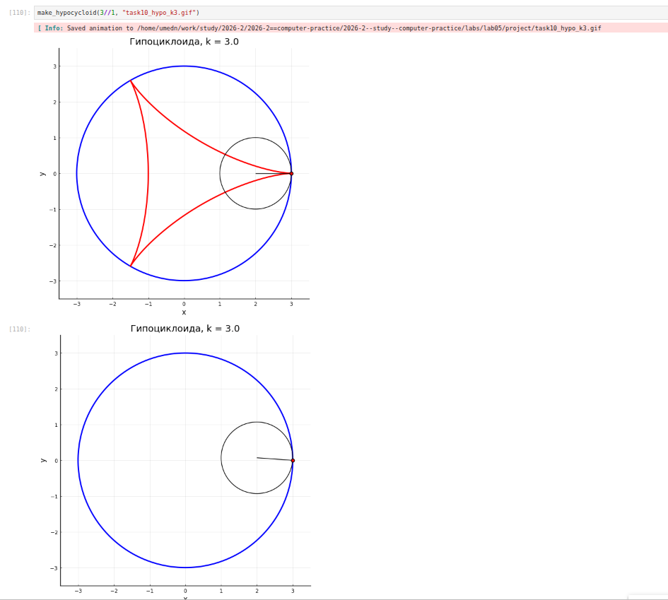{#fig-073 width=85%}

При $k=4$ получена гипоциклоида с четырьмя вершинами (@fig-074).

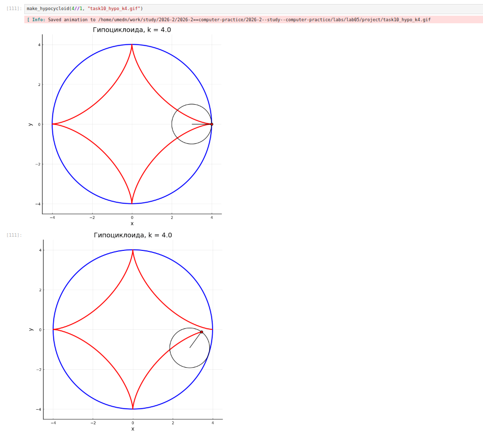{#fig-074 width=85%}

При $k=5/2$ получена замкнутая кривая с самопересечениями (@fig-075).

{#fig-075 width=85%}

Аналогичное построение выполнено при $k=7/2$ (@fig-076).

{#fig-076 width=85%}

Для рационального отношения $k=p/q$, записанного в несократимом виде, параметр изменялся от 0 до $2\pi q$. Это обеспечивает замыкание рассматриваемых кривых.

На скриншотах присутствуют сообщения о сохранении четырёх GIF-файлов.

## Задание 11. Анимированные эпициклоиды

Эпициклоида описывает движение точки окружности, катящейся по внешней стороне неподвижной окружности.

Использовались формулы

$$
x(t)=(R+r)\cos(t)-r\cos((k+1)t),
$$

$$
y(t)=(R+r)\sin(t)-r\sin((k+1)t),
\qquad k=\frac{R}{r}.
$$

Была создана функция `make_epicycloid`. Для размещения всей кривой область отображения учитывала сумму $R+2r$.

На @fig-078 показан результат при $k=3$.

{#fig-078 width=85%}

На @fig-079 показан результат при $k=4$.

{#fig-079 width=85%}

На скриншотах подтверждено сохранение анимаций для двух целых значений отношения радиусов.

Функция допускает использование рациональных значений. Однако результаты её вызовов при $k=5/2$ и $k=7/2$ в представленных материалах отсутствуют. Для полного подтверждения выполнения задания необходимо добавить эти два результата.

# Результаты

В ходе работы получены следующие результаты:

1. Построены графики функции с использованием различных средств визуализации.
2. Рассмотрено оформление линий, координатных осей, легенд и фона.
3. Выполнено сравнение синуса с его приближением рядом Тейлора.
4. Построены двумерные и трёхмерные точечные графики.
5. Выполнено приближение случайных данных полиномом пятой степени.
6. Построены графики с двумя вертикальными шкалами.
7. Рассмотрены полярные и параметрические графики.
8. Построены поверхности, линии уровня и градиентное поле.
9. Рассмотрены способы отображения симметричных и асимметричных интервалов.
10. Построены гистограммы случайных данных.
11. Созданы простые и сложные макеты подграфиков.
12. Сформированы последовательности кадров для анимаций.
13. Подтверждено сохранение четырёх анимаций гипоциклоид и двух анимаций эпициклоид.

# Обсуждение результатов

Результаты показали, что выбор типа графика зависит от характера данных и цели исследования.

Линейные графики удобны для отображения изменения функции, точечные для отдельных наблюдений, а гистограммы для исследования распределения значений.

При сравнении функций с различными диапазонами значений общая шкала может скрывать изменение одной из них. Использование двух осей ординат улучшает видимость, но требует внимательного чтения подписей шкал.

Уменьшение шага сетки делает поверхность более гладкой, одновременно увеличивая количество вычисляемых точек.

Графические механизмы имеют различия в поддержке параметров и способах отображения. В работе это проявилось при выводе Plotly в JupyterLab и использовании стиля `:dashdotdot` в PyPlot.

При построении гипоциклоид выявлена необходимость корректного вычисления центра движущейся окружности. В итоговой функции центр задавался координатами

$$
c_x=(R-r)\cos(t),\qquad
c_y=(R-r)\sin(t).
$$

Для эпициклоиды вместо $R-r$ использовалось $R+r$.

Не все результаты можно подтвердить неподвижными скриншотами. Скриншот показывает отдельный кадр, а для проверки движения необходимо открыть соответствующий GIF-файл.

Отдельной доработки требуют пример с шестью типами подграфиков, визуальное подтверждение гистограммы смеси распределений и результаты эпициклоид для двух нецелых рациональных значений.

# Заключение

В ходе лабораторной работы освоены основные команды Julia для построения и оформления графиков.

Получены навыки работы с линейными и точечными графиками, гистограммами, поверхностями, линиями уровня и векторными полями.

Рассмотрены построение графиков с двумя вертикальными осями, настройка макетов подграфиков и отображение неопределённости.

Изучен принцип создания анимации как последовательности кадров. Реализованы функции построения гипоциклоид и эпициклоид.

Цель освоения основных средств визуализации достигнута. Для полного завершения всех пунктов необходимо устранить отмеченные ограничения и дополнить отсутствующие результаты.

# Список литературы {.unnumbered}

1. Кулябов Д. С. и др. Компьютерный практикум на языке Julia. Лабораторная работа №5 «Построение графиков». Методические указания. С. 37–64.

\appendix

# Основные фрагменты кода {.appendix}

Листинги команд и результаты их выполнения представлены на скриншотах в основной части отчёта. Ниже приведены основные конструкции, использованные в работе.

## Построение и сохранение графика

```julia
using Plots

f(x) = (3*x^2 + 6*x - 9) * exp(-0.3*x)

x = collect(range(-5, 10, length=151))
y = f.(x)

p = plot(
    x, y,
    xlabel="x",
    ylabel="f(x)",
    label="f(x)",
    linewidth=2
)

savefig(p, "function_graph.png")
```

## Приближение полиномом

```julia
A = [ones(length(x)) x x.^2 x.^3 x.^4 x.^5]

c = A \ y

y_fit = c[1] .+ c[2] .* x .+ c[3] .* x.^2 .+
        c[4] .* x.^3 .+ c[5] .* x.^4 .+ c[6] .* x.^5
```

## Градиент функции

```julia
h(x, y) = x^3 - 3*x + y^2

x_grid = range(-2, stop=2, length=12)
y_grid = range(-2, stop=2, length=12)

px = [a for a in x_grid for b in y_grid]
py = [b for a in x_grid for b in y_grid]

u = (3 .* px.^2 .- 3) ./ 25
v = (2 .* py) ./ 25
```

## Общий принцип создания анимации

```julia
x_sin = collect(range(0, stop=2*pi, length=120))
y_sin = sin.(x_sin)

anim = @animate for j in eachindex(x_sin)
    plot(
        x_sin[1:j], y_sin[1:j],
        xlims=(0, 2*pi),
        ylims=(-1.2, 1.2),
        xlabel="x",
        ylabel="sin(x)",
        label="sin(x)"
    )
end

gif(anim, "sine.gif", fps=20)
```