---
## Author
author:
  name: Умед Джамшедович Назармамадов
  affiliation:
    - name: Российский университет дружбы народов
      country: Российская Федерация
      postal-code: 117198
      city: Москва
      address: ул. Миклухо-Маклая, д. 6

## Title
title: Лабораторная работа №6
subtitle: Решение моделей в непрерывном и дискретном времени
license: CC BY
date: today
date-format: "YYYY-MM-DD"
---

<!-- Пути к рисункам рассчитаны на расположение презентации в labs/lab06/presentation и скриншотов в labs/lab06/report/image. -->

# Информация

## Докладчик

- Назармамадов Умед Джамшедович
- Студент группы НФИбд-02-23
- Факультет физико-математических и естественных наук
- Российский университет дружбы народов

::: notes
Здравствуйте! Меня зовут Назармамадов Умед. Представляю лабораторную работу номер шесть по решению моделей в непрерывном и дискретном времени на языке Julia.
:::

# Вводная часть

## Актуальность

- Динамические модели описывают изменение системы во времени
- Непрерывные модели задают скорость изменения состояния
- Дискретные модели задают переход от одного шага к следующему
- Графики и фазовые портреты помогают увидеть рост, колебания и приближение к равновесию

::: notes
Одна и та же идея применяется к разным задачам. Сначала мы задаём правило изменения системы, затем вычисляем её состояние во времени и смотрим, как ведёт себя решение.
:::

## Объект и предмет исследования

- **Объект исследования** включает непрерывные и дискретные динамические модели
- **Предмет исследования** охватывает численные решения, фазовые траектории и равновесия

::: notes
Я рассматривал модели роста популяций, распространения инфекции и механических колебаний. По графикам определял, как меняется состояние каждой системы.
:::

## Цель и задачи

**Цель работы** состоит в освоении пакетов Julia для решения задач в непрерывном и дискретном времени.

- Повторить три примера из методических указаний
- Выполнить восемь самостоятельных заданий
- Построить графики, фазовые портреты и анимации
- Сравнить решения и проверить результаты вычислений

::: notes
Сначала я повторил примеры из методички, а затем применил те же инструменты в самостоятельных заданиях.
:::

## Материалы и методы

- Julia и JupyterLab с ядром IJulia
- `DifferentialEquations` и метод `Tsit5()` для решения ОДУ
- Прямые итерации и линеаризация для дискретной модели
- `Plots` с бэкендом PyPlot для графиков и GIF-анимаций

::: notes
Для непрерывных моделей я задавал уравнения, начальные условия и интервал времени. В дискретной модели следующее состояние вычислял напрямую из текущего.
:::

# Ход работы

## Экспоненциальный рост

- Задача $u'=0{,}98u$ с начальным условием $u(0)=1$
- Точное решение $u(t)=e^{0{,}98t}$
- При строгих допусках максимальная ошибка уменьшилась примерно в 619 раз

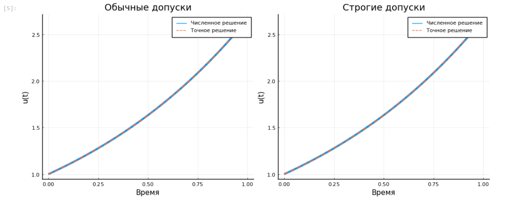{width=94%}

::: notes
Я решил одно уравнение с двумя наборами допусков. На графиках кривые почти совпадают с точным решением, но сравнение чисел показало, что строгие допуски заметно снизили ошибку.
:::

## Система Лоренца

- Слева траектория по точкам, сохранённым решателем
- Справа та же траектория на равномерной сетке из 6000 точек

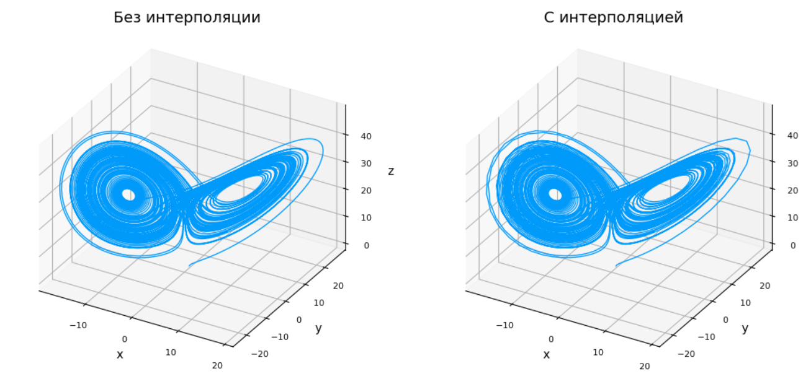{width=92%}

::: notes
Я построил аттрактор Лоренца двумя способами. На обоих графиках видны два лепестка. Для правого графика значения между сохранёнными точками получены интерполяцией.
:::

## Непрерывная модель Лотки–Вольтерры

- Численности жертв и хищников колеблются
- Пики численности хищников наступают позже пиков численности жертв

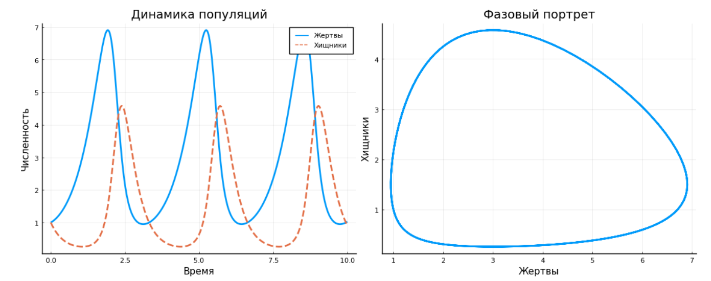{width=95%}

::: notes
Сначала растёт численность жертв. Затем увеличивается численность хищников. После этого численность жертв снижается, и цикл повторяется. Справа этот цикл виден как замкнутая траектория.
:::

## Модели Мальтуса и логистического роста

- В обеих моделях $x(0)=10$ и коэффициент роста равен $0{,}2$
- При $t=20$ модель Мальтуса даёт $545{,}98$, логистическая модель даёт $85{,}85$

::: {layout-ncol=2}
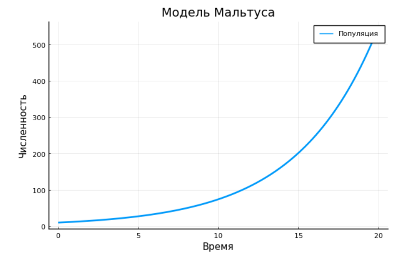

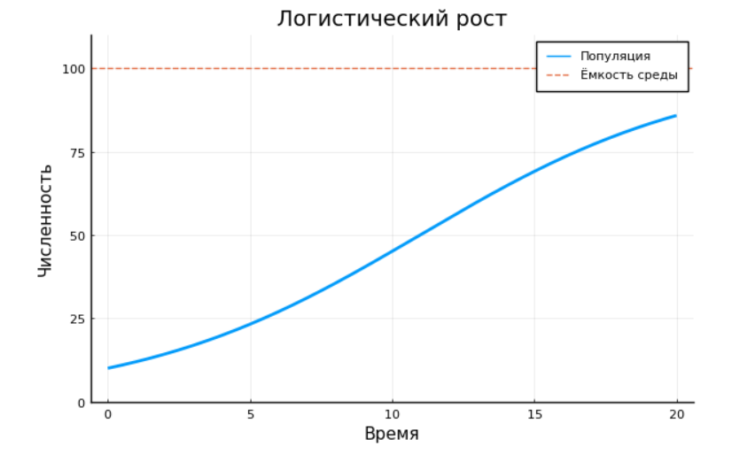
:::

::: notes
У обеих моделей одинаковое начальное состояние. В логистической модели задана ёмкость среды 100, поэтому рост замедляется при приближении к этому пределу.
:::

## Модели SIR и SEIR

- В SIR три группы: восприимчивые $S$, заразные $I$ и выбывшие $R$
- В SEIR добавлена скрытая стадия $E$
- Сумма долей в обеих моделях сохраняется

::: {layout-ncol=2}
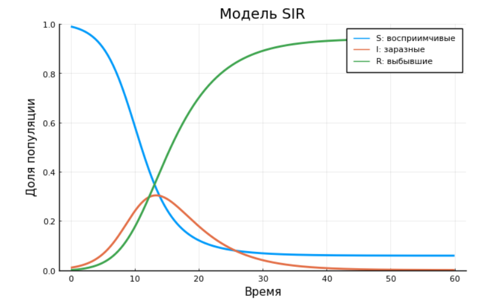

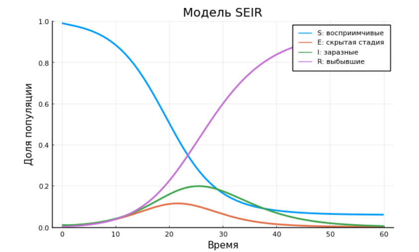
:::

::: notes
В обеих моделях численность населения считается постоянной. Разница заключается в том, когда заражённые начинают передавать инфекцию. В SEIR они сначала проходят скрытую стадию.
:::

## Сравнение пиков SIR и SEIR

| Модель | Пиковая доля заразных | Время пика |
|:--|--:|--:|
| SIR | 30,38 % | 13,4 |
| SEIR | 19,86 % | 25,4 |

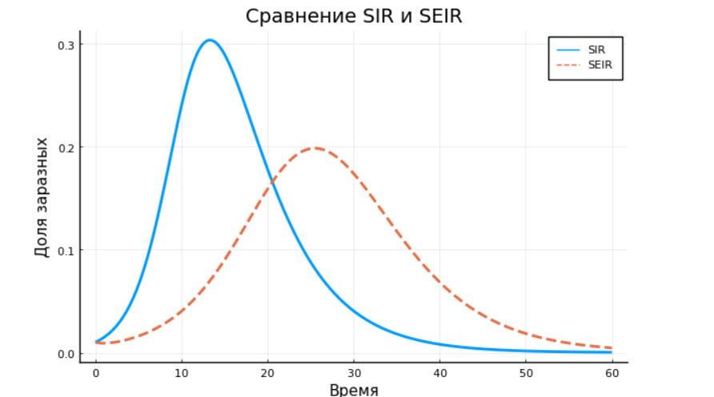{height=300px}

::: notes
При выбранных параметрах пик в SEIR наступил на 12 единиц времени позже и был ниже на 10,52 процентного пункта.
:::

## Дискретная модель Лотки–Вольтерры

- Точка сосуществования $(0{,}4;\,0{,}2)$
- Выполнено 30 итераций из начальной точки $(0{,}41;\,0{,}19)$
- Прямые итерации и линейное приближение сходятся к равновесию по спирали

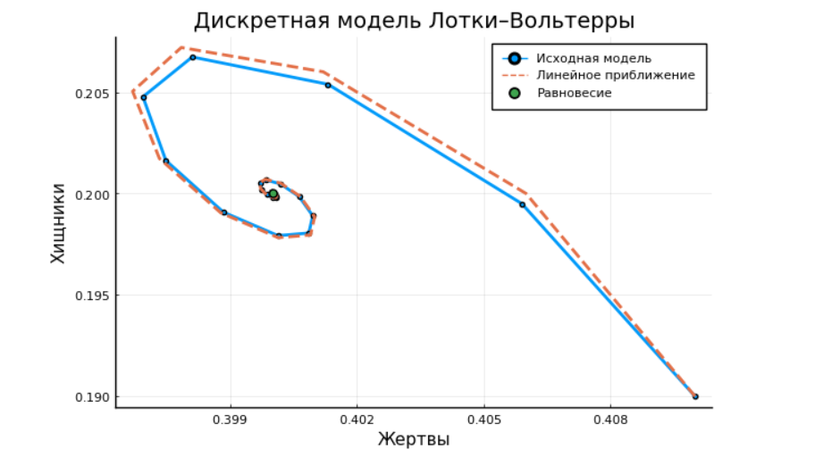{height=320px}

::: notes
Равновесие нашёл из условия, что обе численности остаются прежними на следующем шаге. Затем взял начальную точку рядом с равновесием и сравнил исходную модель с линейным приближением.
:::

## Конкуренция популяций

- Начальные численности равны 12 и 8
- При одинаковом коэффициенте роста первая популяция растёт, вторая сокращается
- Разность численностей равна $4e^{0{,}4t}$

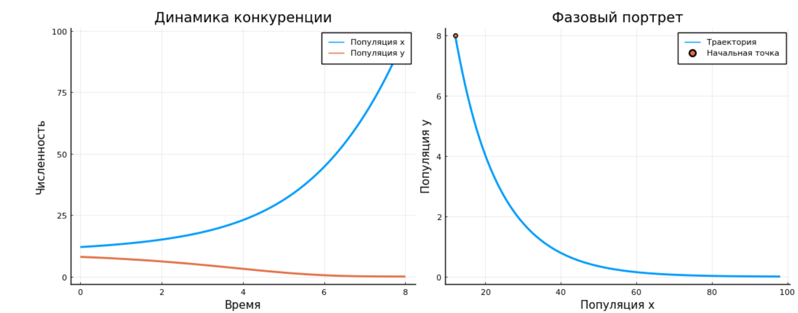{width=95%}

::: notes
Обе популяции имеют одинаковый коэффициент роста, но разные начальные численности. Для выбранных условий преимущество первой популяции со временем увеличивается.
:::

## Осциллятор без затухания

- Начальное смещение $x(0)=1$, начальная скорость $v(0)=0$
- Амплитуда постоянна, фазовая траектория имеет форму окружности
- Энергия численного решения остаётся близкой к $0{,}5$

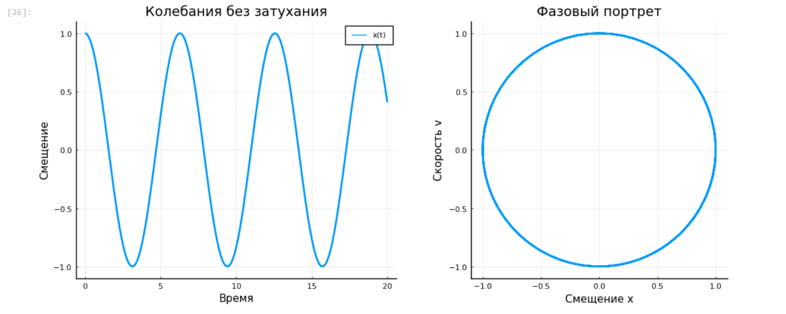{width=94%}

::: notes
В первом случае тело отпускают без начальной скорости. Сопротивление отсутствует, поэтому амплитуда остаётся постоянной, а фазовая траектория замыкается.
:::

## Осциллятор с затуханием

- Те же начальные условия и коэффициент затухания $\gamma=0{,}2$
- Амплитуда уменьшается, фазовая траектория сходится к началу координат
- Энергия снизилась с $0{,}5$ до примерно $0{,}0002083$ при $t=20$

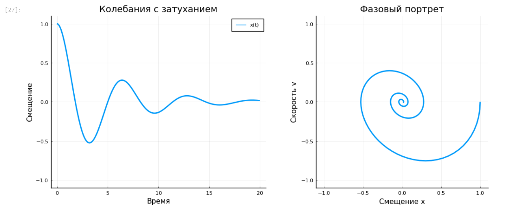{width=94%}

::: notes
При затухании система теряет энергию. На графике смещения это видно по уменьшению амплитуды, а на фазовом портрете по спирали, которая приближается к равновесию.
:::

# Результаты

## Что получено

- Воспроизведены три примера и выполнены восемь самостоятельных заданий
- Построены графики и фазовые портреты, сохранены шесть GIF-анимаций
- Оценена ошибка относительно точного решения для экспоненциального роста
- Проверены равновесия дискретной модели, суммы долей в SIR и SEIR и энергия осцилляторов

::: notes
Для проверки я сравнивал решение с точной формулой и проверял величины, которые должны сохраняться. Для дискретной модели дополнительно сравнил две траектории вблизи равновесия.
:::

# Заключение

## Главный вывод

Численное решение в Julia позволяет проследить изменение состояния системы во времени. Графики показывают рост и колебания, а фазовые портреты помогают увидеть периодическое движение и приближение к равновесию.

::: notes
В этой работе я научился задавать непрерывные и дискретные модели, рассчитывать их траектории и объяснять полученные результаты. Спасибо за внимание!
:::