---
author:
  name: Умед Джамшедович Назармамадов
  affiliation:
    - name: Российский университет дружбы народов
      country: Российская Федерация
      postal-code: 117198
      city: Москва
      address: ул. Миклухо-Маклая, д. 6

title: "Лабораторная работа №6"
subtitle: "Решение моделей в непрерывном и дискретном времени"
date: "2026-11-22"
license: "CC BY"
lang: ru
toc: true
number-sections: true
abstract: |
  В работе численно решены модели роста популяций, взаимодействия видов,
  распространения инфекции и гармонических колебаний. Для дискретной модели
  Лотки–Вольтерры найдены равновесия и выполнено сравнение прямых итераций
  с аналитическим приближением в окрестности точки сосуществования.
keywords: [Julia, динамические модели, дифференциальные уравнения, фазовый портрет]
---

**Группа:** НФИбд-02-23

# Введение

## Актуальность

Динамические модели описывают, как меняется состояние системы со временем. Непрерывные процессы можно задавать дифференциальными уравнениями, а дискретные процессы описываются правилом перехода от одного шага к следующему. Графики и фазовые портреты позволяют увидеть рост, периодические колебания и приближение к равновесию.

## Цель работы

Освоить специализированные пакеты Julia для решения задач в непрерывном и дискретном времени.

## Задачи

1. Повторить в JupyterLab примеры экспоненциального роста, системы Лоренца и непрерывной модели Лотки–Вольтерры из раздела 6.2 методических указаний.
2. Выполнить восемь заданий из раздела 6.4. Исследовать модели Мальтуса, логистического роста, SIR и SEIR, дискретную модель Лотки–Вольтерры, конкуренцию популяций и гармонические колебания без затухания и с затуханием.
3. Построить графики, фазовые портреты и анимации для соответствующих заданий. Сравнить численное решение с точным, найти равновесия и проверить сохранение величин в моделях, где это применимо.

## Объект и предмет исследования

Объект исследования составляют динамические модели в непрерывном и дискретном времени. Предмет исследования включает методы численного решения и свойства полученных траекторий.

## Методы исследования

Использовались численное интегрирование ОДУ, прямые итерации разностных уравнений, линеаризация в окрестности равновесия и анализ графиков.

## Схема выполнения работы

1. Подготовить среду Julia и JupyterLab.
2. Задать уравнения, параметры и начальные условия.
3. Найти численные решения непрерывных и дискретных моделей.
4. Построить графики, фазовые портреты и анимации.
5. Сравнить решения и проверить результаты.

# Теоретическая часть

Непрерывная модель задаёт скорость изменения состояния $u(t)$ уравнением $u'=f(u,p,t)$. Для решения задают начальное состояние, параметры $p$ и интервал времени. В дискретной модели следующее состояние определяется отображением $u_{n+1}=F(u_n)$. Точка $u_*$ является равновесием, если $F(u_*)=u_*$.

На фазовом портрете по осям откладываются компоненты состояния. Например, для осциллятора это смещение $x$ и скорость $v$. Замкнутая траектория соответствует периодическому движению. Спираль, приближающаяся к началу координат, указывает на затухание колебаний.

В моделях SIR и SEIR состояние описывается долями населения в разных группах. При сложении правых частей уравнений переходы между группами сокращаются, поэтому сумма долей сохраняется. Для осциллятора можно проверить энергию $H=(v^2+\omega_0^2x^2)/2$. Из уравнений движения следует $H'=-2\gamma v^2$. При $\gamma=0$ энергия постоянна, а при $\gamma>0$ она убывает.

# Материалы и методы

Вычисления проводились на Julia в блокноте JupyterLab. Непрерывные модели задавались через `ODEProblem` пакета `DifferentialEquations` и решались методом `Tsit5()`. Параметры `abstol` и `reltol` управляют допустимой локальной погрешностью, а `saveat` задаёт моменты сохранения результата. Для графиков использовался пакет `Plots` с бэкендом PyPlot. Кадры формировались макросом `@animate` и сохранялись в формате GIF с частотой 10 кадров в секунду.

# Выполнение лабораторной работы

## Подготовка рабочей среды

В каталоге `labs/lab06/project` я запустил JupyterLab и подготовил блокнот с ядром Julia (рис. -@fig-jupyter). В блокноте установил пакет `DifferentialEquations` и подключил его вместе с `Plots` (рис. -@fig-install).

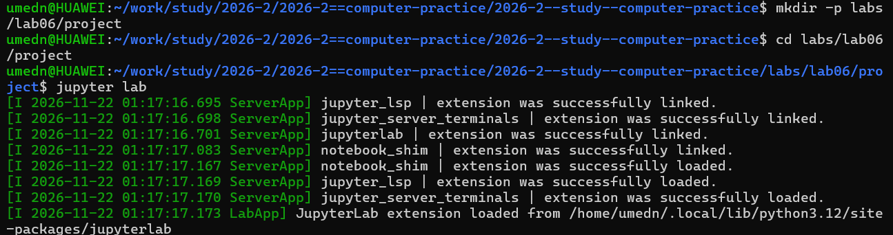{#fig-jupyter width=100%}

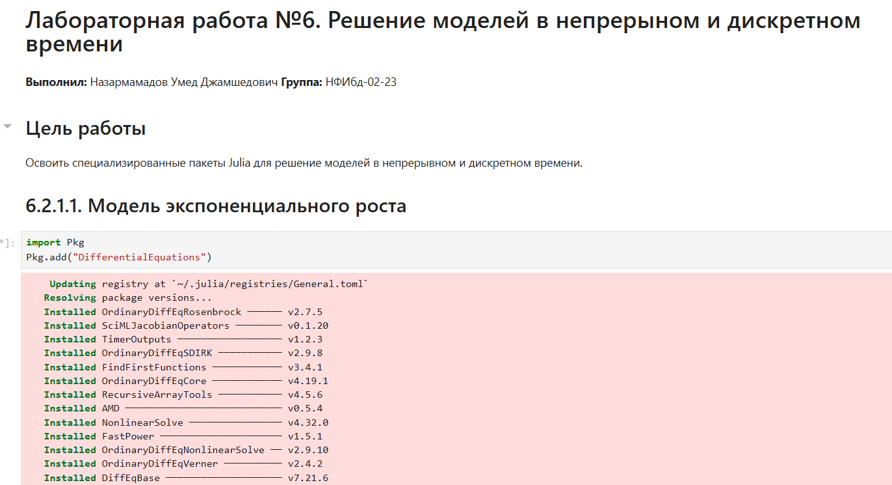{#fig-install width=100%}

## Примеры из методических указаний

### Экспоненциальный рост (6.2.1.1)

Для задачи $u'=0{,}98u$, $u(0)=1$ на интервале $[0,1]$ использовал точное решение $u(t)=e^{0{,}98t}$. Решил задачу с обычными допусками и с $\mathrm{abstol}=\mathrm{reltol}=10^{-8}$. В обоих случаях сравнил численное и точное решения в сохранённых точках с интервалом $0{,}02$. Расчёт максимальной ошибки представлен на рис. -@fig-growth-error, а сравнение кривых показано на рис. -@fig-growth.

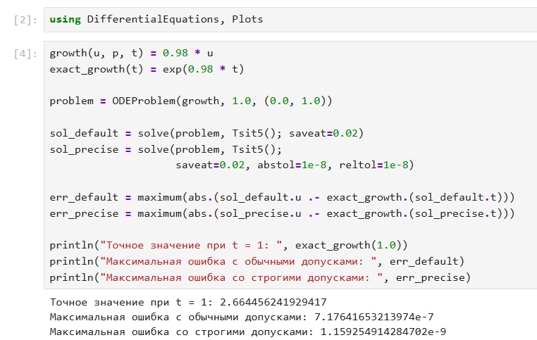{#fig-growth-error width=88%}

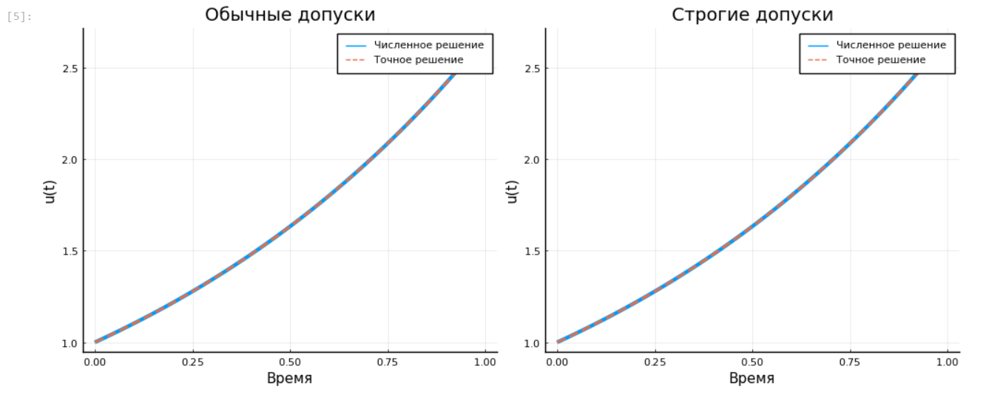{#fig-growth width=100%}

### Система Лоренца (6.2.1.2)

Решил систему $x'=\sigma(y-x)$, $y'=x(\rho-z)-y$, $z'=xy-\beta z$ с параметрами $(\sigma,\rho,\beta)=(10,28,8/3)$ и начальным состоянием $(1,0,0)$ на интервале $[0,100]$. Первый фазовый портрет построил по узлам, сохранённым решателем. Для второго вычислил значения той же траектории на равномерной сетке из 6000 точек с помощью интерполяции. На обоих графиках видна двухлепестковая форма аттрактора (рис. -@fig-lorenz).

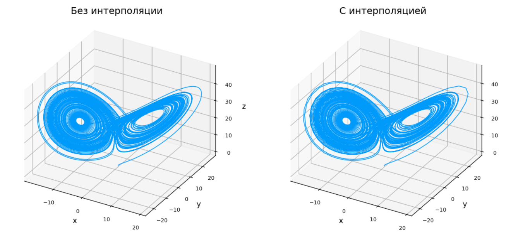{#fig-lorenz width=100%}

### Непрерывная модель Лотки–Вольтерры (6.2.2)

Для численностей жертв $x$ и хищников $y$ задал систему $x'=ax-bxy$, $y'=-cy+dxy$. Взял $(a,b,c,d)=(1{,}5;\,1;\,3;\,1)$, начальные численности $(1,1)$ и интервал $[0,10]$. По рассчитанным значениям построил графики $x(t)$, $y(t)$ и фазовый портрет $y(x)$ (рис. -@fig-lv).

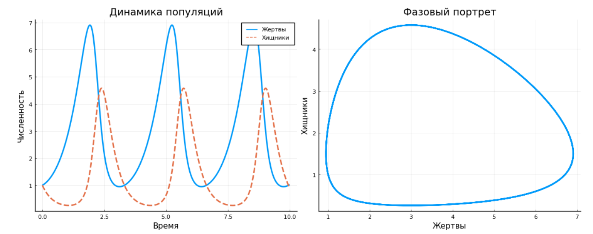{#fig-lv width=100%}

## Самостоятельные задания

### Модель Мальтуса (6.4.1)

Для изолированной популяции задал $x'=(b-c)x$, $x(0)=10$, $b=0{,}3$ и $c=0{,}1$. Рождаемость выше смертности, поэтому разность $b-c=0{,}2$ задаёт положительный темп роста. Решил задачу на интервале $[0,20]$ и построил график (рис. -@fig-malthus). Анимацию сохранил в файле `04_malthus.gif` (рис. -@fig-malthus-gif).

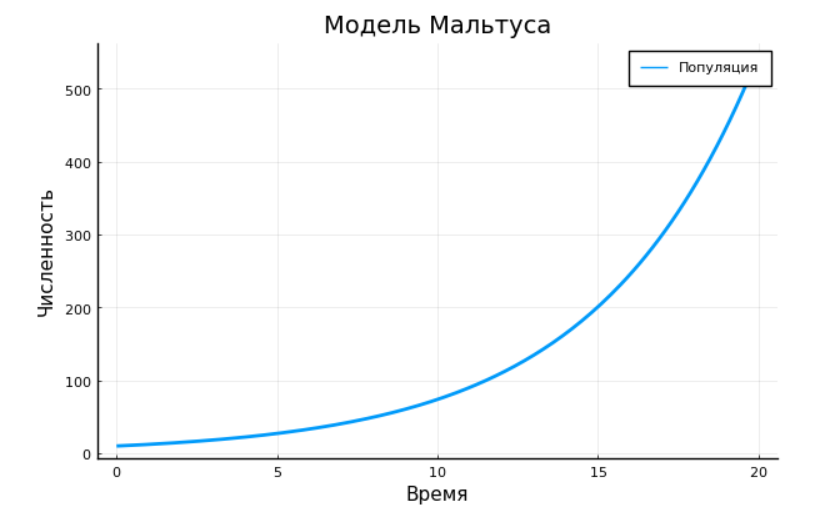{#fig-malthus width=76%}

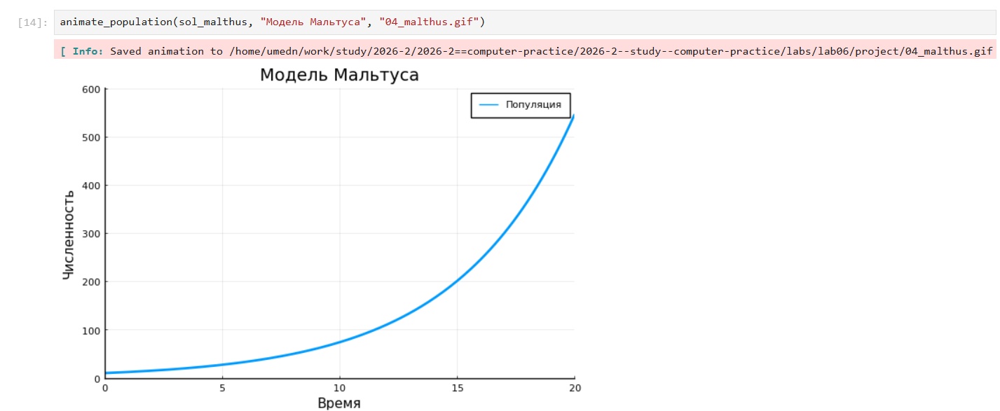{#fig-malthus-gif width=91%}

### Логистическая модель роста (6.4.2)

Решил уравнение $x'=rx(1-x/K)$ на том же интервале. Начальное значение $x(0)=10$ и темп $r=0{,}2$ оставил такими же для сравнения с моделью Мальтуса. Выбрал ёмкость среды $K=100$, чтобы популяция начинала с одной десятой предельной численности. На графике ёмкость среды показана пунктиром (рис. -@fig-logistic). Анимацию сохранил в файле `05_logistic.gif` (рис. -@fig-logistic-gif).

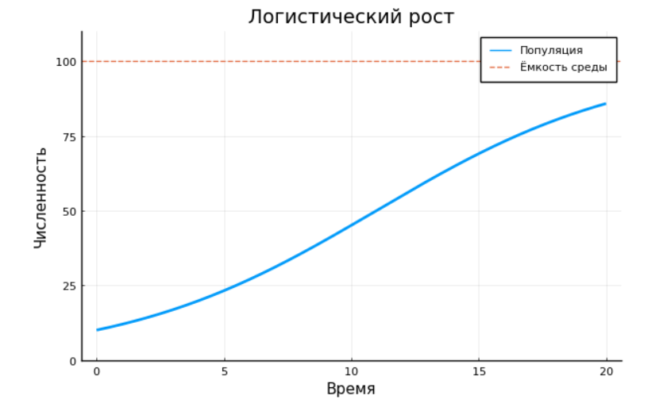{#fig-logistic width=76%}

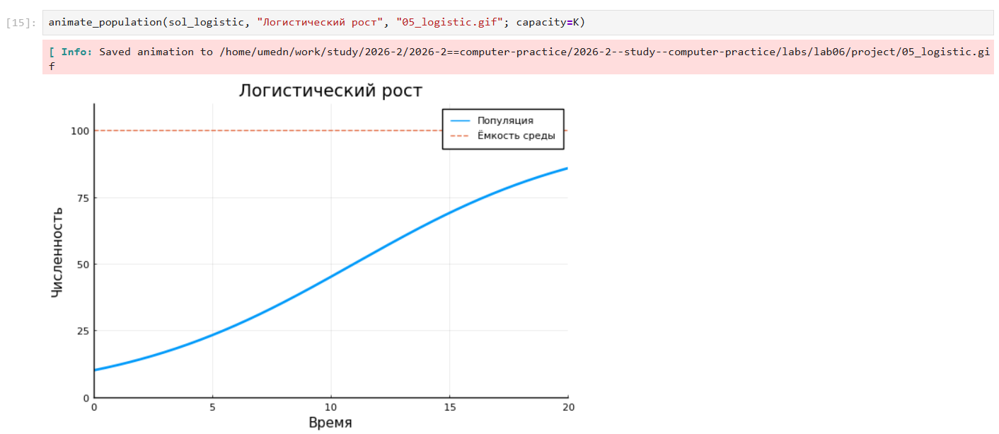{#fig-logistic-gif width=91%}

### Модель SIR (6.4.3)

Рассмотрел группы восприимчивых $S$, заразных $I$ и выбывших из процесса передачи инфекции $R$. Использовал систему

$$
S'=-\beta SI,\qquad I'=\beta SI-\gamma I,\qquad R'=\gamma I.
$$

В начале расчёта доля заразных составляла $0{,}01$, доля восприимчивых $0{,}99$, а доля выбывших была равна нулю. При $\beta=0{,}6$ и $\gamma=0{,}2$ величина $\beta S(0)-\gamma$ положительна, поэтому доля заразных сначала увеличивается. Рассчитал динамику на интервале $[0,60]$ (рис. -@fig-sir) и сохранил анимацию `06_sir.gif` (рис. -@fig-sir-gif).

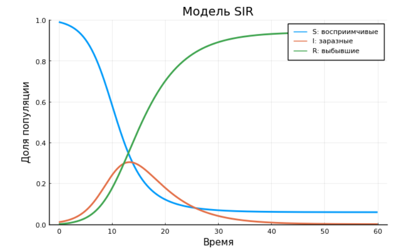{#fig-sir width=76%}

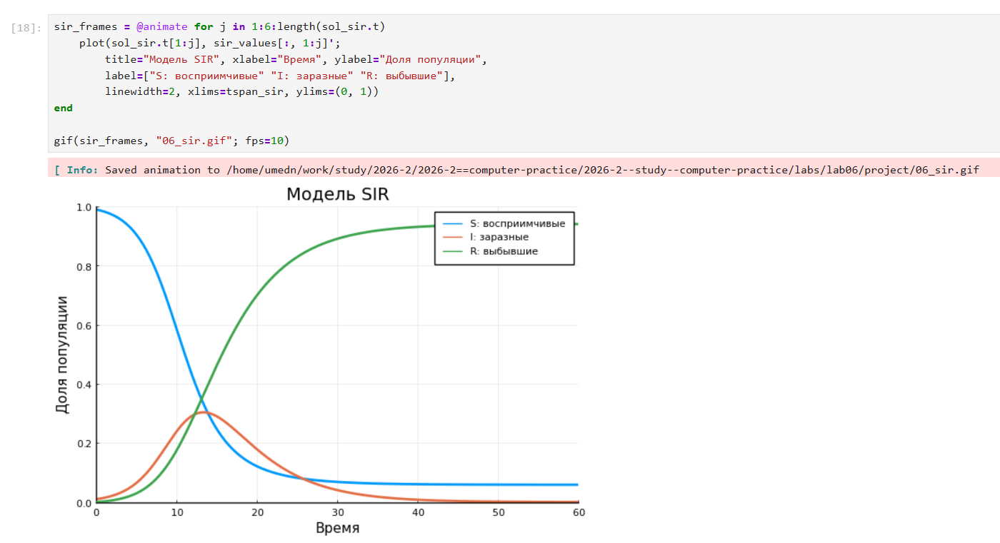{#fig-sir-gif width=91%}

### Модель SEIR и сравнение с SIR (6.4.4)

Добавил группу $E$, в которую входят заражённые в скрытой стадии. Уравнения для нормированных долей имеют вид

$$
S'=-\beta SI,\quad E'=\beta SI-\delta E,\quad I'=\delta E-\gamma I,\quad R'=\gamma I.
$$

Использовал те же $\beta$, $\gamma$, начальные $S$, $I$, $R$ и интервал времени. Задал $E(0)=0$ и скорость перехода к заразной стадии $\delta=0{,}4$. Построил динамику четырёх групп (рис. -@fig-seir). По сохранённым точкам с интервалом $0{,}2$ нашёл максимальные доли заразных и проверил сохранение суммы долей (рис. -@fig-seir-check). Кривые $I(t)$ двух моделей сравнил на одном графике (рис. -@fig-seir-compare).

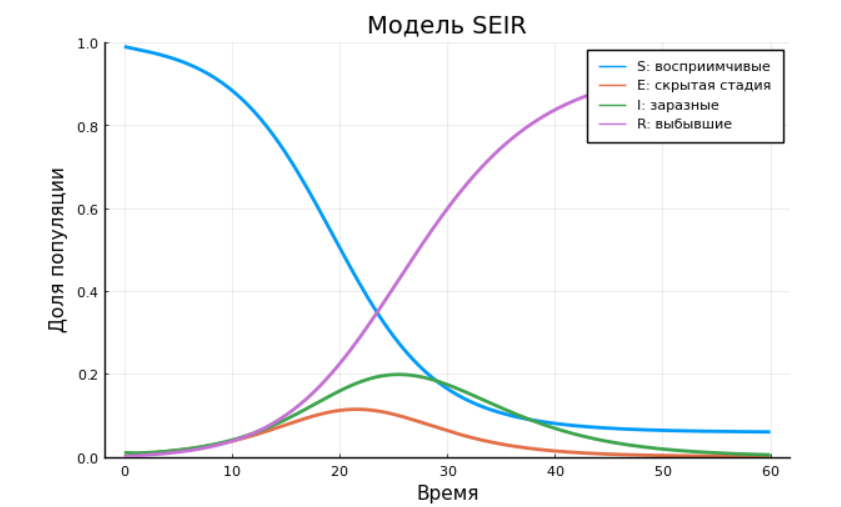{#fig-seir width=76%}

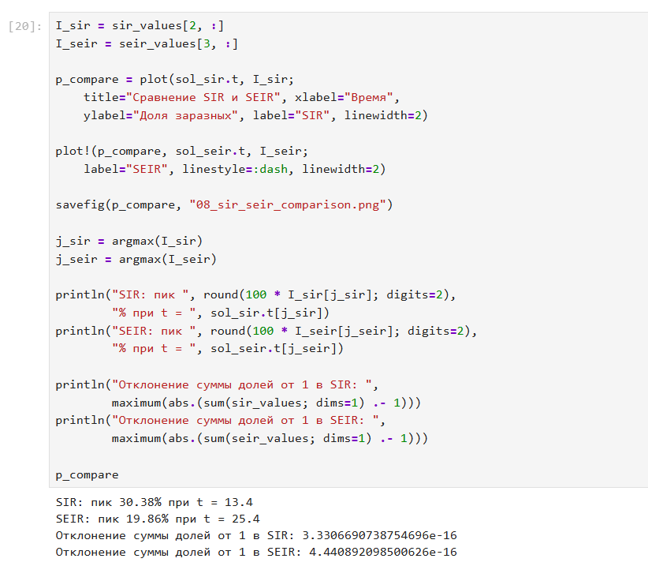{#fig-seir-check width=82%}

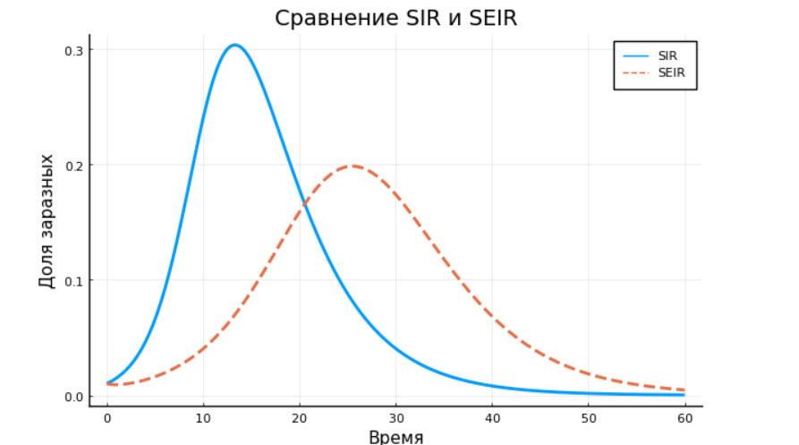{#fig-seir-compare width=81%}

### Дискретная модель Лотки–Вольтерры (6.4.5)

При $a=2$, $c=1$ и $d=5$ модель принимает вид

$$
x_{n+1}=2x_n(1-x_n)-x_ny_n,\qquad y_{n+1}=-y_n+5x_ny_n.
$$

Для равновесия положил $x_{n+1}=x_n=x$, $y_{n+1}=y_n=y$ и получил

$$
x(1-2x-y)=0,\qquad y(5x-2)=0.
$$

При $y=0$ получаются точки $(0,0)$ и $(0{,}5;\,0)$. При $y\ne0$ из второго уравнения следует $x=0{,}4$, а из первого $y=0{,}2$. Если начать точно в точке сосуществования $u_*=(0{,}4;\,0{,}2)$, аналитическое решение будет равно $u_n=u_*$ для любого $n$.

Для начальной точки $u_0=(0{,}41;\,0{,}19)$ выполнил 30 итераций исходных уравнений. Для сравнения использовал аналитическое решение линеаризованной системы, которое приближает исходную траекторию вблизи равновесия.

$$
u_n^{\mathrm{lin}}=u_*+J^n(u_0-u_*),\qquad
J=\begin{pmatrix}0{,}2&-0{,}4\\1&1\end{pmatrix}.
$$

После первого шага исходное отображение даёт $(0{,}4059;\,0{,}1995)$, а линейное приближение даёт $(0{,}406;\,0{,}200)$. На фазовом портрете обе траектории приближаются к точке сосуществования по спирали (рис. -@fig-discrete).

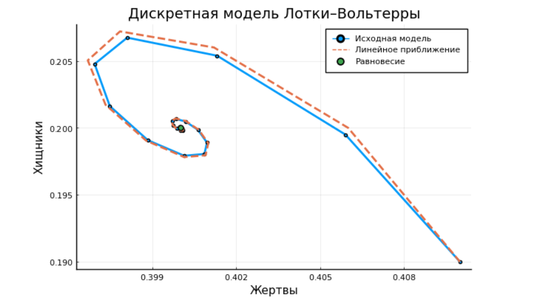{#fig-discrete width=82%}

### Конкуренция популяций (6.4.6)

Для системы $x'=\alpha x-\beta xy$, $y'=\alpha y-\beta xy$ взял одинаковый коэффициент роста $\alpha=0{,}4$ и коэффициент конкуренции $\beta=0{,}04$. Начальные значения $x(0)=12$ и $y(0)=8$ выбрал разными, чтобы проверить, как меняется начальное преимущество первой популяции. На интервале $[0,8]$ построил графики численностей и фазовый портрет (рис. -@fig-competition). Сохранил анимацию `10_competition.gif` (рис. -@fig-competition-gif).

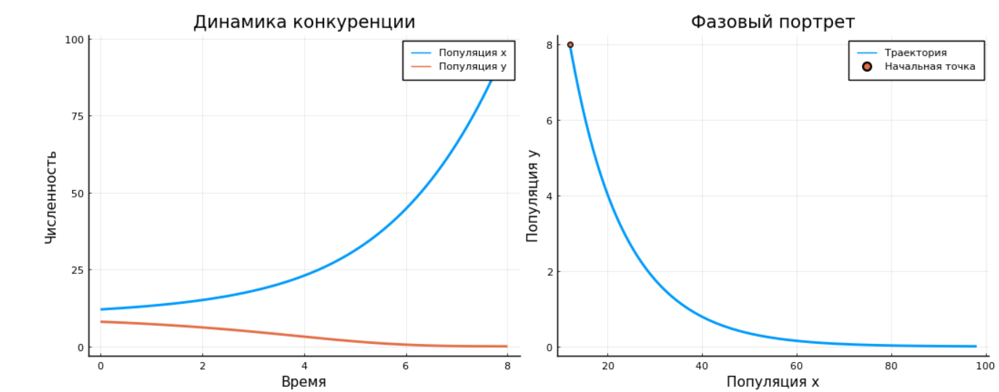{#fig-competition width=100%}

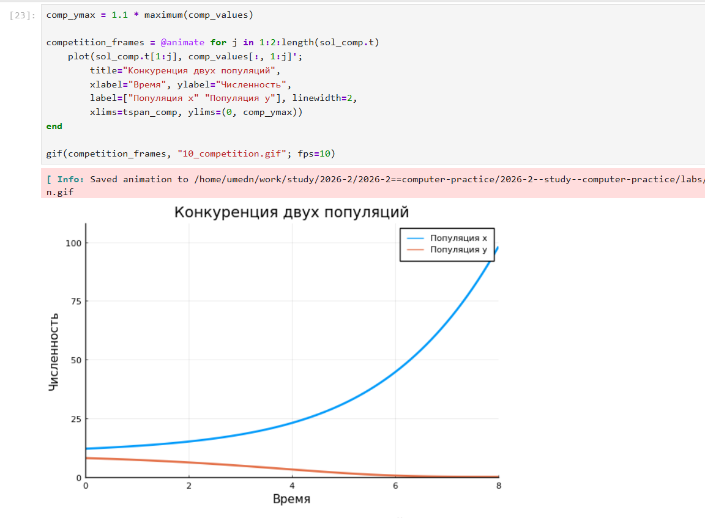{#fig-competition-gif width=91%}

### Консервативный гармонический осциллятор (6.4.7)

Записал уравнение второго порядка в виде системы $x'=v$, $v'=-\omega_0^2x-2\gamma v$. Взял $x(0)=1$ и $v(0)=0$. Это соответствует отклонению тела от равновесия с последующим отпусканием без толчка. При $\omega_0=1$ и $\gamma=0$ точное решение имеет вид $x(t)=\cos t$, $v(t)=-\sin t$. Построил график $x(t)$ и фазовый портрет на интервале $[0,20]$ (рис. -@fig-osc-free). Анимацию сохранил в файле `11_oscillator_free.gif` (рис. -@fig-osc-free-gif).

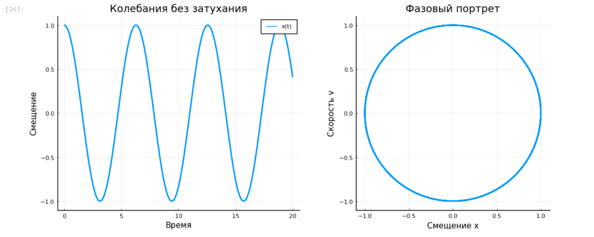{#fig-osc-free width=100%}

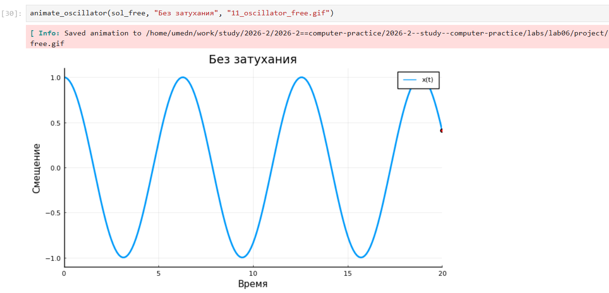{#fig-osc-free-gif width=91%}

### Гармонический осциллятор с затуханием (6.4.8)

Оставил начальные условия, собственную частоту и интервал времени прежними. Выбрал $\gamma=0{,}2$. Поскольку $0<\gamma<\omega_0$, решение остаётся колебательным, а амплитуда постепенно уменьшается. Построил график смещения и фазовый портрет (рис. -@fig-osc-damped), сохранил анимацию `12_oscillator_damped.gif` (рис. -@fig-osc-damped-gif). Для обоих осцилляторов вычислил энергию по численному решению в начале и конце интервала (рис. -@fig-osc-energy).

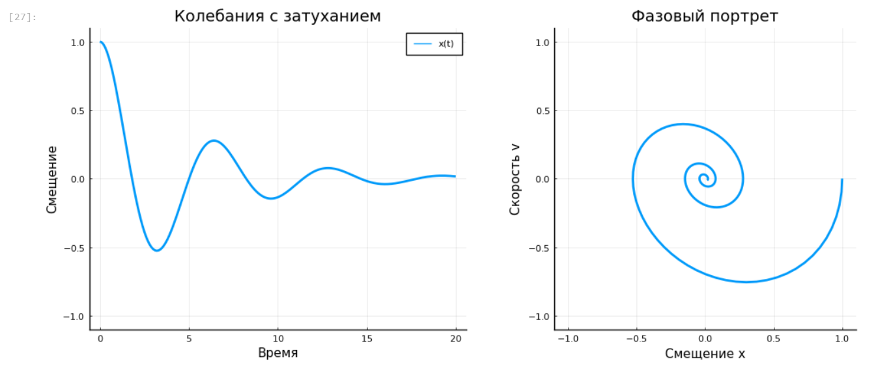{#fig-osc-damped width=100%}

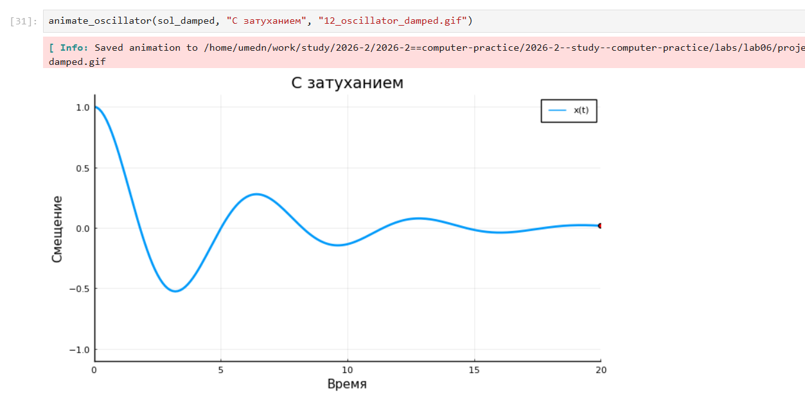{#fig-osc-damped-gif width=91%}

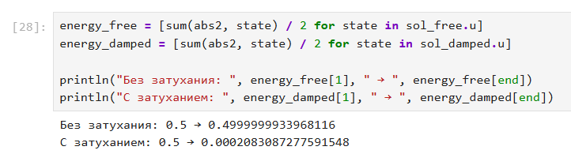{#fig-osc-energy width=87%}

# Результаты

| Модель или проверка | Полученный результат |
|:--|:--|
| Экспоненциальный рост | Точное значение $u(1)=2{,}664456241929417$. Максимальные ошибки $7{,}1764\cdot10^{-7}$ при обычных допусках и $1{,}1593\cdot10^{-9}$ при строгих |
| Модель Мальтуса | $x(20)\approx545{,}98$ |
| Логистический рост | $x(20)\approx85{,}85$ при $K=100$ |
| SIR | Максимальная доля заразных $30{,}38\%$ при $t=13{,}4$. Максимальное отклонение суммы долей от единицы составило примерно $3{,}33\cdot10^{-16}$ |
| SEIR | Максимальная доля заразных $19{,}86\%$ при $t=25{,}4$. Максимальное отклонение суммы долей от единицы составило примерно $4{,}44\cdot10^{-16}$ |
| Дискретная модель Лотки–Вольтерры | Обе траектории сближаются с точкой $(0{,}4;\,0{,}2)$ |
| Осциллятор без затухания | $H(0)=0{,}5$, $H(20)\approx0{,}4999999934$ |
| Осциллятор с затуханием | $H(0)=0{,}5$, $H(20)\approx0{,}0002083087$ |

# Обсуждение результатов

В примере экспоненциального роста уменьшение допусков снизило максимальную ошибку примерно в 619 раз. На масштабе графиков обе численные кривые практически совпадают с точной. В системе Лоренца оба способа построения дают одинаковую общую форму аттрактора, поскольку интерполяция применяется к уже вычисленному решению.

В непрерывной модели Лотки–Вольтерры пик численности хищников следует за пиком численности жертв, а фазовая траектория замкнута. В дискретной модели с выбранными параметрами видно приближение к равновесию по спирали. Собственные значения матрицы $J$ равны $0{,}6\pm i\sqrt{0{,}24}$, их модуль равен $\sqrt{0{,}6}<1$. Это объясняет затухание малых отклонений при последовательных итерациях.

Сравнение моделей роста при одинаковых $x(0)$ и коэффициенте роста показывает влияние ёмкости среды. В логистической модели рост замедляется при приближении к $K=100$. В модели Мальтуса рост на рассматриваемом интервале ускоряется.

При добавлении скрытой стадии максимум доли заразных наступил на 12 единиц времени позже и снизился на $10{,}52$ процентного пункта. В обеих моделях сумма долей сохранялась в пределах погрешности вычислений.

В модели конкуренции численность первой популяции росла, а второй уменьшалась. Если вычесть уравнения, слагаемые конкуренции сократятся и получится $(x-y)'=\alpha(x-y)$. Поэтому при выбранных начальных условиях разность численностей растёт как $4e^{0{,}4t}$.

Фазовая траектория осциллятора без затухания имеет форму окружности, а численная энергия остаётся почти постоянной. В модели с затуханием энергия снижается, и фазовая траектория приближается к $(0,0)$ по спирали.

# Заключение

В ходе работы я освоил численное решение непрерывных моделей в Julia и расчёт дискретных траекторий по разностным уравнениям. Воспроизвёл три примера из методических указаний и выполнил восемь самостоятельных заданий. Построенные графики, фазовые портреты и анимации показали особенности каждой модели. Сравнение с точным решением, проверка суммы долей и расчёт энергии позволили проверить полученные результаты.

# Список литературы {.unnumbered}

1. Кулябов Д. С. и др. *Компьютерный практикум на языке Julia*. Лабораторная работа №6 «Решение моделей в непрерывном и дискретном времени». С. 65–72.

